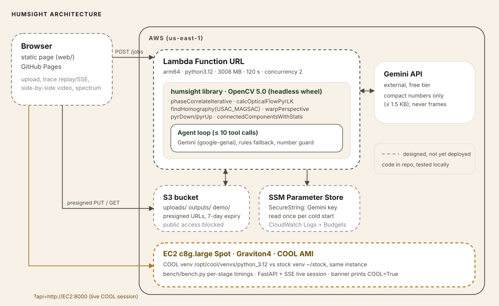

# HumSight

*See what machines are humming.*

HumSight turns an ordinary video of a machine into a grid of "virtual vibration sensors":

1. **Measure.** OpenCV 5 phase correlation measures sub-pixel motion per patch; an FFT finds frequency, amplitude and SNR.
2. **Decide.** A bounded agent separates a real machine fault from camera shake and noise, escalates from a coarse to a fine scan, and asks for human review when the evidence is thin.
3. **Show.** A band-limited Eulerian magnification of the faulty region only, a heatmap, a spectrum and a work order.

Every number shown anywhere is computed by OpenCV/NumPy code in this repo. The LLM only chooses tools and writes prose, and a number guard replaces any summary containing a number that no tool produced.

> Indicative, camera-based measurement. Not a certified ISO assessment.

Built for the [OpenCV AI Competition 2026, powered by AWS](https://opencv26.devpost.com/) (paths: Agentic Vision with OpenCV 5; Best Use of COOL, with an honest null benchmark result).



## Submission map

Each row is something the competition asks for, where it lives, and its honest status.

| Requirement | Where | Status |
|---|---|---|
| Technical report (problem, users, architecture, OpenCV 5, AWS, evaluation, limitations, responsible use) | [docs/TECHNICAL_REPORT.md](docs/TECHNICAL_REPORT.md) | written; AWS and COOL sections report the 24 Oct 2026 runs |
| Code repository, pinned dependencies | this repo, `requirements.txt`, `requirements-lambda.txt` | done |
| Build, deployment and test instructions | [docs/JUDGING.md](docs/JUDGING.md) (test), [docs/DEPLOYMENT.md](docs/DEPLOYMENT.md) (AWS) | test: done and verified; AWS steps written, **not executed** |
| Architecture diagram (OpenCV 5, AWS, COOL, agent) | [docs/architecture.svg](docs/architecture.svg), [docs/agent_workflow.svg](docs/agent_workflow.svg) | done |
| Working web endpoint or live screen-share | `lambda_fn/`, `server/`, `web/` | **live**: page https://santiwari07.github.io/HumSight/ calling an AWS Lambda Function URL; also runs locally |
| Meaningful component on AWS | Lambda (arm64) + S3 + SSM run the whole OpenCV 5 pipeline and the agent; a COOL Graviton4 instance ran the benchmark | **deployed and tested** (the instance is terminated) |
| Evaluation evidence with failure cases | `eval/results/summary.md`, `eval/results/failure_cases.md` | done on synthetic ground truth; real clip (E8) **not run** |
| Agentic Vision evidence: workflow diagram, trace where OpenCV output changes a later call, failure handling, human control | [docs/agent_workflow.svg](docs/agent_workflow.svg), [docs/example_trace.md](docs/example_trace.md) | done; the Gemini policy was run live on Lambda once (8 model-chosen tool calls, FAULT); not yet evaluated systematically |
| Best Use of COOL evidence: version, instance, method, results | [docs/COOL.md](docs/COOL.md), `bench/`, [evidence/](evidence/README.md) | **run on a Graviton4 Spot instance; null result** (0.98x to 1.03x vs stock, OpenCV 5.1.0-dev vs 5.0.0); screenshots and renders kept |
| Video, 5 minutes or less | | **pending, after deployment** |
| Devpost text | [docs/DEVPOST_SUBMISSION.md](docs/DEVPOST_SUBMISSION.md) | draft with TODOs |

## Try it locally

```bash
python -m venv .venv && .venv/Scripts/activate        # Windows; use .venv/bin/activate elsewhere
pip install -r requirements.txt
python scripts/make_demo_clips.py                      # deterministic, lossless demo clips (~50 MB each, not in git)
uvicorn server.app:app --port 8000                     # open http://localhost:8000
python -m pytest                                       # 31 tests
```

The page is a four-step flow: pick a recording, check the setup (leave the method on *Agent with rules*), watch the activity log stream live, then read the diagnosis (status, key readings, video, spectrum, heatmap, findings, work order). Choose **Fixed pipeline** on `pump_shake_fault` to see the naive approach magnify the camera shake instead of the fault. Expected result per demo: [docs/JUDGING.md](docs/JUDGING.md).

Gemini (optional): put `GEMINI_API_KEY=...` in a git-ignored `.env`. Without a key the *Agent (Gemini)* option is disabled and the rules policy runs the same tools; if a Gemini call fails mid-job the rest of the job runs on rules and the trace says so. The UI follows [docs/design.md](docs/design.md).

## Repository layout

```
README.md  LICENSE  requirements.txt  requirements-lambda.txt  pyproject.toml
docs/                  report, diagrams, example trace, deployment, COOL evidence, judging guide,
                       Devpost draft, design system, planning/ (PRD and implementation plan)
humsight/              core library (no web or cloud code): synth, io, texture, motion, spectrum,
                       shake, detect, magnify, severity, report, pipeline (fixed baseline)
humsight/agent/        tools, state, trace, rules policy, Gemini provider, number guard, loop
server/                FastAPI + SSE (local and EC2)
lambda_fn/             Lambda handler + Docker-free arm64 build script
web/                   static page (GitHub Pages)
deploy/                S3 / Lambda / CORS / IAM templates for docs/DEPLOYMENT.md
bench/                 COOL vs stock benchmark harness (results land in bench/RESULTS.md)
eval/                  E1-E8 scripts, failure cases, generated results in eval/results/
scripts/               demo clips, EC2 setup, COOL proof, trace export, S3 upload, result embedding
tests/                 accuracy checkpoint, units, agent behaviour, Gemini wiring, Lambda, server
demo_clips/            demo metadata and ground truth (clips are generated, not committed)
.github/workflows/     manual GitHub Pages deploy
```

## How it works

| Stage | OpenCV / NumPy | Notes |
|---|---|---|
| sub-pixel motion | `cv2.phaseCorrelateIterative` on Hann-windowed patches, `L2size=5` | plain `cv2.phaseCorrelate` gave gross outliers on our synthetic textures |
| shake, method A | median background displacement subtracted | best for translation |
| shake, method B | `goodFeaturesToTrack`, `calcOpticalFlowPyrLK`, `findHomography(USAC_MAGSAC)`, `warpPerspective` | rotation/zoom; interpolation slightly smooths sub-pixel signals |
| localisation | `connectedComponentsWithStats` on the fault-patch grid | coarse 8×6 then 32 px fine grid in the ROI |
| magnification | `pyrDown`/`pyrUp` Laplacian pyramid + FFT band-pass (Wu et al. 2012) | finest level not amplified; α clipped to the small-motion bound; ROI only |
| amplitude | least-squares sine fit at the refined peak frequency | unbiased |

Day-1 codec check on the development laptop (Windows, `opencv-python-headless==5.0.0.93`): `avc1` is unavailable (no OpenH264); `VP80` (`.webm`) and `mp4v` work. The code tries `avc1`, `VP80`, `mp4v` in that order. Re-run `probe_codecs` on Lambda and COOL and record the result in the report.

More: [docs/TECHNICAL_REPORT.md](docs/TECHNICAL_REPORT.md) covers the agent design, guardrails, evaluation tables, failure cases, limitations and responsible use.

## Limitations

- Severity is indicative; no ISO 20816 zone is reported until thresholds from a cited part and machine class are configured.
- Frequency is valid only below Nyquist; give the expected Hz/RPM so the aliasing guard can work. `capture_fps` is mandatory for uploads.
- Lossy re-compression removes or fakes sub-pixel motion; transfer originals.
- A machine that fills the frame and vibrates as a whole looks like camera shake to this method.
- All results so far are on synthetic clips.

## Cost and credits

Local runs cost nothing. No AWS resource has been created from this repo, so the AWS cost so far is zero; the planned spend is estimated in [docs/planning/IMPLEMENTATION.md](docs/planning/IMPLEMENTATION.md) §9.8 and the real figure must come from your Billing console. `scripts/teardown_checklist.md` lists what to delete afterwards.

Wu, Rubinstein, Shih, Guttag, Durand, Freeman, *Eulerian Video Magnification for Revealing Subtle Changes in the World*, SIGGRAPH 2012. Hrazdira et al., iterative phase correlation (as implemented in OpenCV). OpenCV and Cloud-Optimized OpenCV (COOL). All clips in this repo are synthetic.

MIT licence.
