<p align="center">
  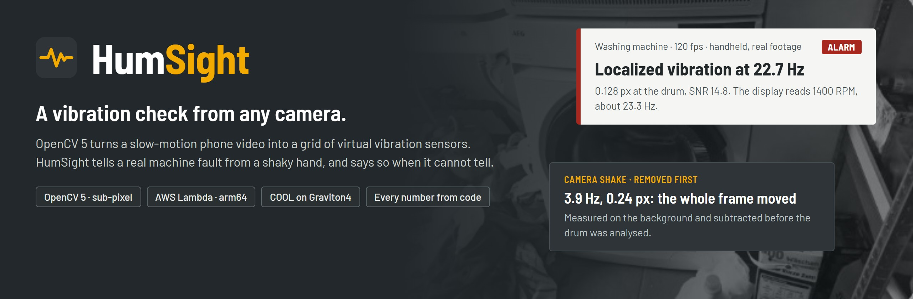
</p>

<p align="center">
  
  
  
  
  
  
</p>

<p align="center">
  <a href="https://santiwari07.github.io/HumSight/"><b>Live demo</b></a> ·
  <a href="#night-shift-pump-hall-3">The problem</a> ·
  <a href="#what-humsight-does">What it does</a> ·
  <a href="#a-walk-through-the-app">Screens</a> ·
  <a href="#how-humsight-thinks">How it thinks</a> ·
  <a href="#architecture">Architecture</a> ·
  <a href="#running-on-aws">Running on AWS</a> ·
  <a href="#the-competition-point-by-point">Competition</a> ·
  <a href="#run-it">Run it</a>
</p>

---

## Night shift, pump hall 3

You are the maintenance technician on nights at a water-treatment plant. Pump 7 sounds a little different tonight. To the eye it looks exactly as it always does: perfectly still.

Pump 7 has no vibration sensor. Wired sensors go on the few most critical machines, and Pump 7 is not one of them. A vibration specialist means a ticket and a wait, and a bearing that is going does not wait.

So you take out your phone, switch to slow motion at 240 frames per second, and film the pump for three seconds. You are holding the phone in your hand. Your arm sways about half a pixel, three and a half times a second. The fault you are looking for moves the bearing cap by a twentieth of a pixel.

A magnifying app would make your hand look like the fault. A vibration report that cannot tell the two apart is worse than none: it sends you to strip down a healthy pump, or it teaches you to stop trusting the report.

**HumSight was built for that check.** About thirty seconds after the upload it answers: *Alarm. Localized vibration at 58.5 Hz on the bearing cap, 0.047 px. Camera shake at 3.5 Hz was measured, removed and rejected.* Next to your video it plays a slowed copy in which only the bearing cap moves, and it hands you a work order that says what to confirm, and with what, at the next planned stop.

On the next pump the answer is different: *Inconclusive.* That pump turns faster than your camera can sample, so any frequency it measured could be an alias. HumSight does not guess. It asks for a faster recording.

<sub>The scene is illustrative. Its numbers are what the live AWS deployment returned for the <code>pump_shake_fault</code> demo, a synthetic clip with exact ground truth (a 58.5 Hz, 0.05 px fault under 3.5 Hz, 0.6 px of shake). The second pump is the <code>alias_130hz</code> demo. A run on real footage is <a href="#on-real-footage">further down</a>.</sub>

### Why this is hard everywhere, not only in pump hall 3

| Number | What it means |
|---|---|
| **$1.4 trillion** | What unplanned downtime costs the world's 500 largest companies each year, 11 % of their revenue.<sup>[1]</sup> |
| **over 40 %** | Share of the world's electricity used by electric motor-driven systems: the pumps, fans and compressors that run every plant.<sup>[2]</sup> |
| **0.05 px** | How far the fault in the story moves the image. Far below what an eye can see, and ten times smaller than the hand shake around it. |
| **6 of 12** | Test clips on which a fixed "magnify the motion" pipeline reported camera shake as the machine fault (evaluation E5). |

Cameras stopped being the problem years ago. Every technician carries one that records at 240 fps. What is missing is the step after the video: **a measurement that knows what it is looking at**.

## What HumSight does

HumSight turns every patch of a video into a virtual vibration sensor, and then reasons about what those sensors show, the way an analyst would:

1. **Measure.** OpenCV 5 phase correlation measures sub-pixel motion in every patch of every frame. An FFT turns each patch into a frequency, an amplitude and a signal-to-noise ratio.
2. **Decide.** An agent reads those numbers and chooses the next measurement. Is the whole frame moving? Remove the camera shake first. Is there a peak left in one place? Scan that region more finely. Is the frequency near the camera's limit, or is the light flickering? Stop and ask for a better recording.
3. **Show.** Magnify only the faulty region, only in the fault's frequency band, so a person can see what was measured. Add a heatmap, a spectrum, the findings and a work order.

The technician gets **a diagnosis, not a wobbling video**: a verdict in plain words (Alarm, Normal or Inconclusive), the numbers behind it, the steps that produced it, and one recommended action.

<p align="center">
  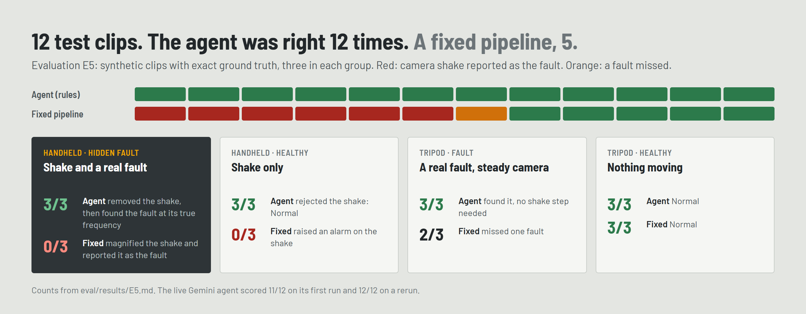
</p>

That is the difference the agent makes on the same OpenCV measurements: **12 of 12 against 5 of 12**, and the fixed pipeline's mistakes are almost all the same one, camera shake reported as the fault.

### Three promises

- **It separates the camera from the machine, and shows its working.** Shake is measured on the background, removed, and named in the report. A result that hides the shake would not be believable.
- **The language model never invents a number.** OpenCV and NumPy produce every number. The model only chooses the next tool and writes the summary. A number guard checks every number in that summary against what the tools returned, and replaces the summary with a template if one does not match.
- **When it cannot tell, it says so.** Aliasing, lighting flicker, low texture, or a noise floor too high to trust a negative all end in *Inconclusive*, with what to change in the next recording. Never a forced guess.

## A walk through the app

Every screen below is a real browser capture of the public site, [santiwari07.github.io/HumSight](https://santiwari07.github.io/HumSight/), with the analysis running on AWS Lambda, taken on 24 October 2026.

<p align="center">
  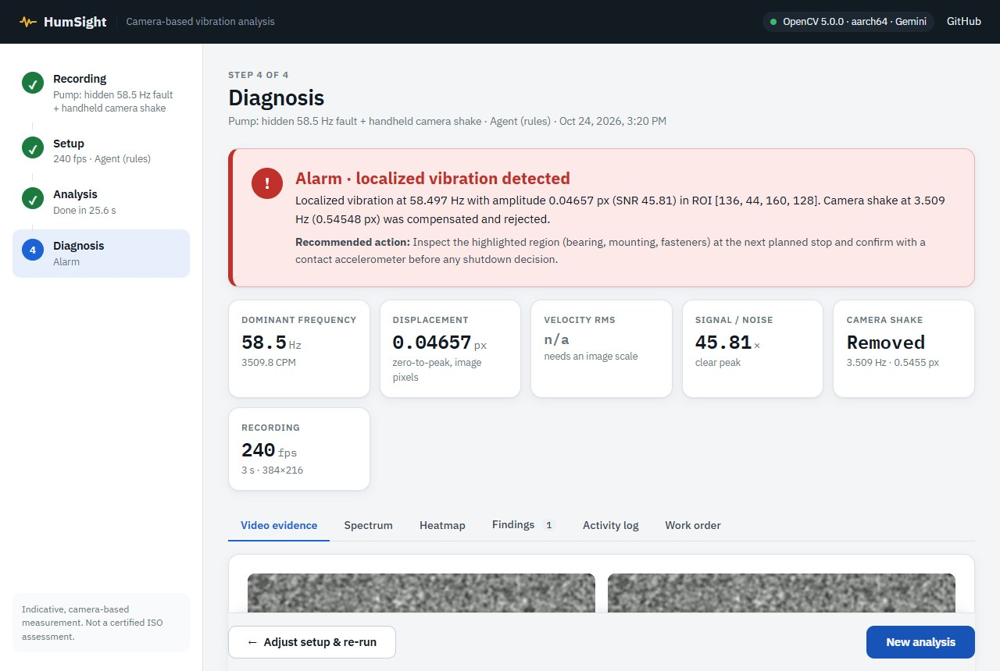
  <br><sub><b>A diagnosis.</b> The verdict in plain words, the recommended action, and the readings behind it: dominant frequency, displacement, signal to noise, and the camera shake that was removed.</sub>
</p>

<table>
<tr>
<td width="50%" valign="top">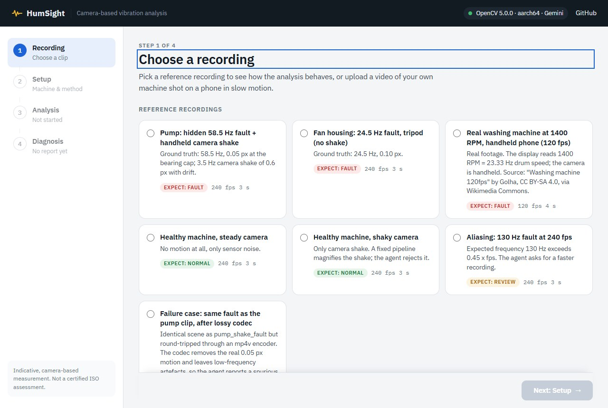<br><b>Choose a recording.</b> Reference clips, each with its ground truth and the outcome to expect, or upload your own slow-motion video.</td>
<td width="50%" valign="top">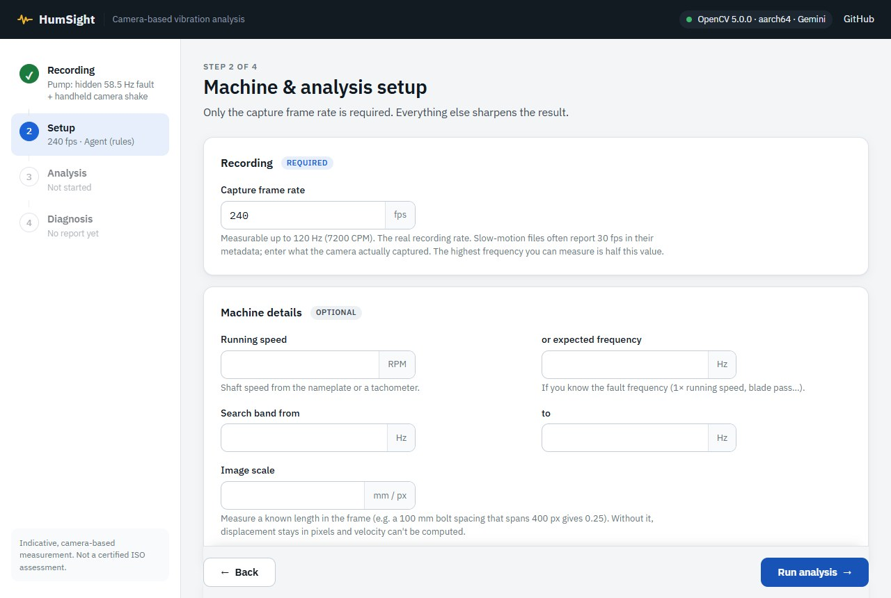<br><b>Set up.</b> Only the capture frame rate is required. Running speed or an expected frequency lets HumSight check for aliasing.</td>
</tr>
<tr>
<td valign="top">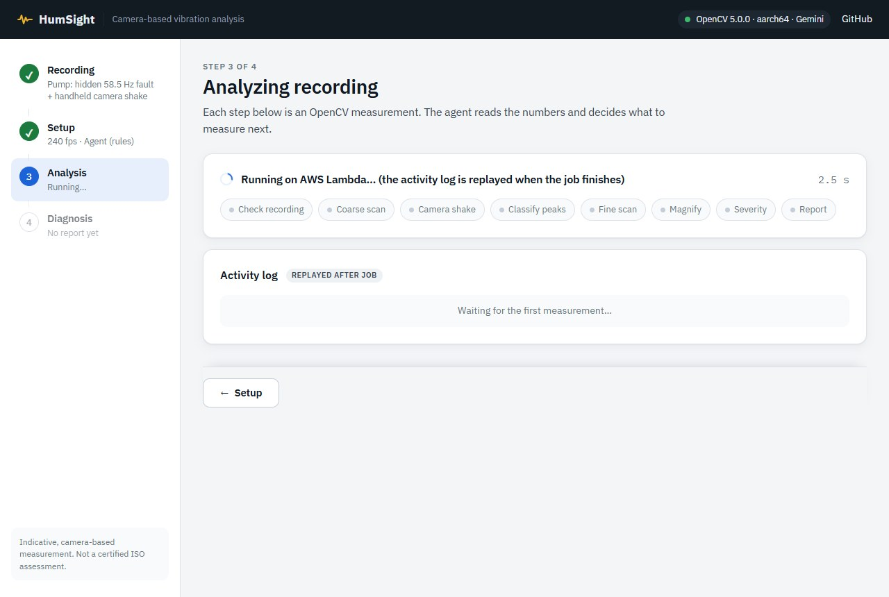<br><b>Running on AWS Lambda.</b> The whole OpenCV 5 pipeline and the agent run in one Lambda invocation. The steps are replayed when the job returns.</td>
<td valign="top">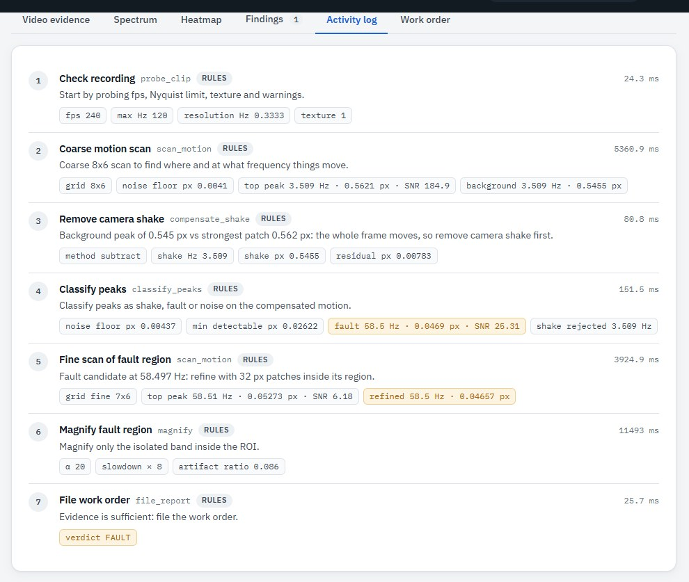<br><b>Activity log.</b> Every tool the agent called, why, and what OpenCV measured. Step 3 is where the background motion made it remove the shake.</td>
</tr>
<tr>
<td valign="top">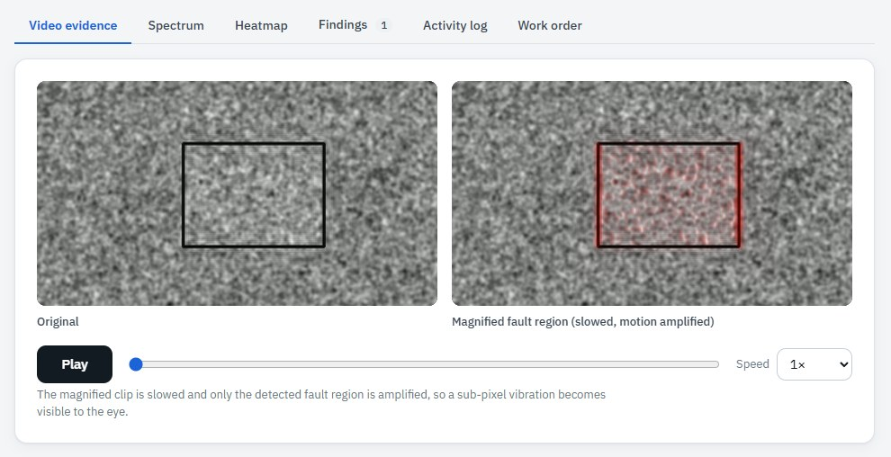<br><b>See it.</b> The original next to a slowed copy in which only the fault region, in only the fault's band, is amplified.</td>
<td valign="top">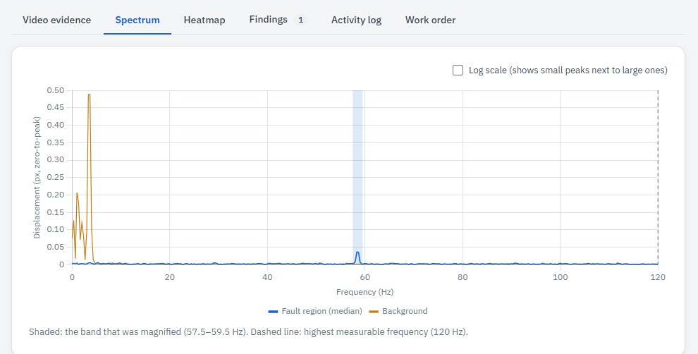<br><b>Spectrum.</b> The background (shake) in orange, the fault region in blue, the magnified band shaded.</td>
</tr>
<tr>
<td valign="top">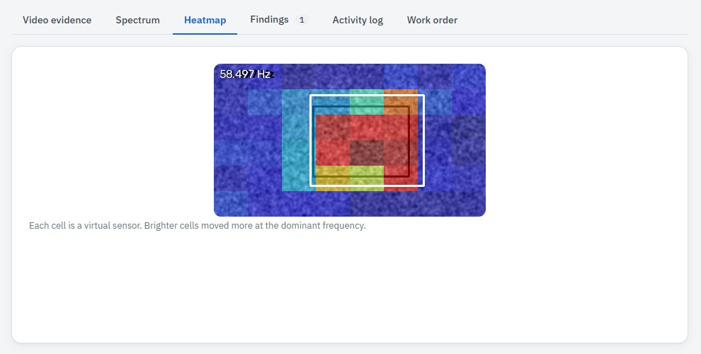<br><b>Heatmap.</b> Each cell is a virtual sensor. The box is the region the fine scan isolated.</td>
<td valign="top">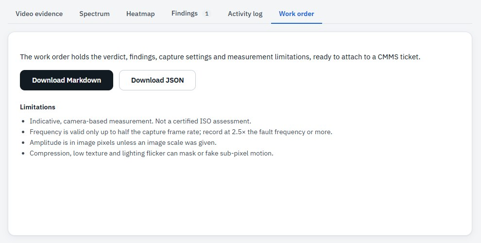<br><b>Work order.</b> The verdict, findings, capture settings and limitations as Markdown or JSON, ready to attach to a maintenance ticket.</td>
</tr>
</table>

### On real footage

The same flow on a real video: a washing machine filmed **handheld** on a phone at 120 fps ([source](https://commons.wikimedia.org/wiki/File:Washing_machine_120fps.webm), CC BY-SA 4.0). HumSight measured the hand shake at 3.9 Hz on the background, removed it, and found a localized 22.7 Hz vibration at the drum. The machine's display reads 1400 RPM, which is 23.3 Hz. That display shows the set spin speed, not a measurement, so this result is indicative, not an accuracy figure.

<table>
<tr>
<td width="50%" valign="top">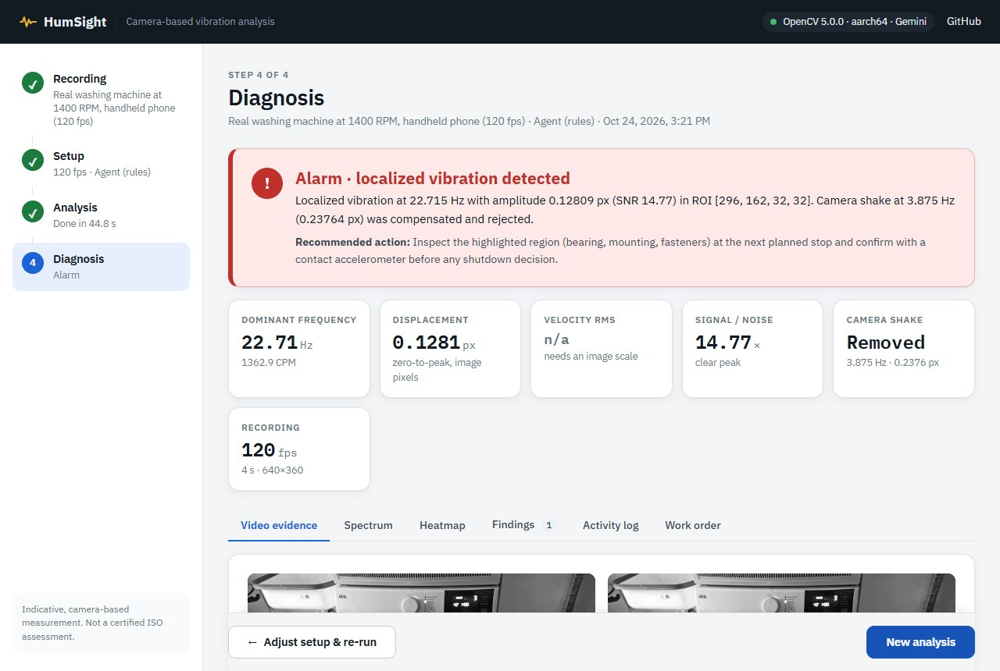</td>
<td width="50%" valign="top">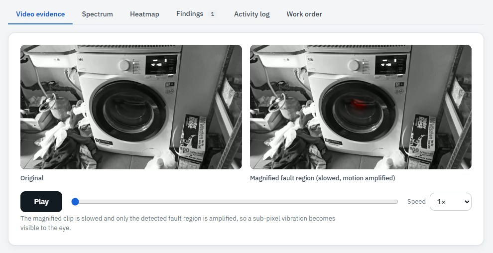</td>
</tr>
</table>

## How HumSight thinks

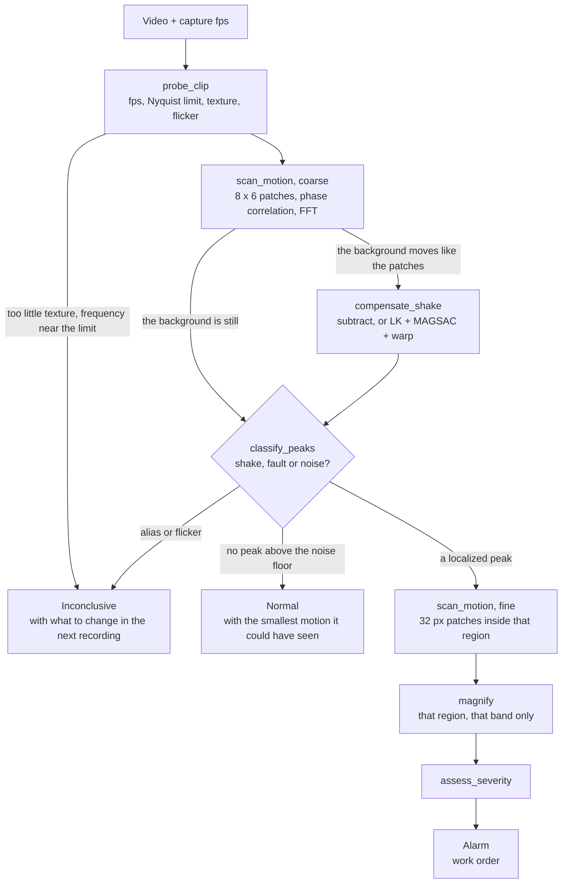

### Measurement first

Eight tools (`humsight/agent/tools.py`) wrap the OpenCV 5 pipeline. Each returns only measured numbers, compacted to at most 1.5 KB, so the model never sees a video frame.

| Tool | What it asks | OpenCV 5 and NumPy underneath |
|---|---|---|
| `probe_clip` | Can this recording be trusted? | Frame rate, Nyquist limit, frequency resolution, texture coverage, flicker |
| `scan_motion` | What moves, where, at what frequency? | `cv2.phaseCorrelateIterative` on Hann-windowed patches, then an FFT per patch |
| `compensate_shake` | Is the camera moving? Remove it. | Median background subtraction, or `goodFeaturesToTrack` + `calcOpticalFlowPyrLK` + `findHomography(USAC_MAGSAC)` + `warpPerspective` |
| `classify_peaks` | Shake, fault or noise? | Peaks against the noise floor (SNR 6) and the background; alias and flicker checks; `connectedComponentsWithStats` for the region |
| `magnify` | Show it to a person. | `pyrDown`/`pyrUp` Laplacian pyramid with an FFT band-pass (Eulerian magnification<sup>[3]</sup>), region only, with an artefact check |
| `assess_severity` | How bad? | Displacement and, given an image scale, velocity in mm/s. Indicative only |
| `request_review` | Stop: the evidence is not good enough. | Terminal, ends in *Inconclusive* |
| `file_report` | Write it down. | Terminal, refuses a verdict filed without a current classification |

### A worked example: the pump

Every row is a real step from the live run in the screenshots above. The *why* column summarises the reason the agent logged before each call; every number in it came from an earlier step.

| Step | Tool | Why | What OpenCV measured |
|---:|---|---|---|
| 1 | `probe_clip` | Probe fps, Nyquist limit and texture first | 240 fps, measurable up to 120 Hz, texture 100 % |
| 2 | `scan_motion` coarse | Find where and at what frequency things move | Strongest patch 0.562 px at 3.509 Hz; background 0.545 px at 3.509 Hz |
| 3 | `compensate_shake` | Background 0.545 px against 0.562 px: the whole frame moves, remove the shake first | Shake 3.509 Hz, 0.5455 px; residual at that frequency 0.00783 px |
| 4 | `classify_peaks` | Classify on the compensated motion | Fault 58.5 Hz, 0.0469 px, SNR 25.31; shake 3.509 Hz rejected |
| 5 | `scan_motion` fine | Fault candidate at 58.497 Hz: refine inside its region | 58.497 Hz, 0.04657 px, SNR 45.8 in a 160 x 128 px region |
| 6 | `magnify` | Magnify only that band in that region | Gain 20, slowed 8 times, artefact ratio 0.086 |
| 7 | `file_report` | The evidence is sufficient | Alarm |

The fixed pipeline on the same clip reports a fault at 3.509 Hz, 0.562 px. That is the technician's hand. The full traces, including the shake-only clip, are in [docs/example_trace.md](docs/example_trace.md).

### Where the language model sits, and where it does not

- **It never measures, and it never states a number of its own.** The number guard compares every number in the summary and the reasoning with the numbers the tools produced. One that does not match replaces the summary with a template.
- **It chooses the next tool, inside a budget.** At most 10 tool calls and 3 magnifications. Arguments are checked against each tool's schema. The tenth call is forced to a terminal tool. An Alarm without the evidence behind it becomes *Inconclusive*.
- **Without it, nothing breaks.** A deterministic rules policy calls the same tools. If Gemini fails partway through a job, the rest runs on rules and the activity log says so. In the live evaluation the model chose all 84 tool calls itself, with no fallback.

## Architecture

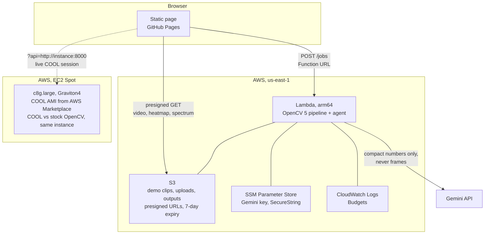

| Layer | Built with |
|---|---|
| Vision | OpenCV 5.0 (`opencv-python-headless`); COOL 5.1.0-dev on Graviton4 |
| Signal processing | NumPy FFT, least-squares sine fit, Laplacian pyramids |
| Agent | Gemini (`google-genai`, `gemini-flash-latest`) with function calling; a deterministic rules policy; the number guard |
| Endpoint | AWS Lambda (arm64, python3.12, 3008 MB) behind a Function URL |
| Storage and secrets | Amazon S3 (public access blocked, presigned URLs), SSM Parameter Store |
| Operations | CloudWatch Logs, AWS Budgets, a teardown checklist |
| Local and EC2 server | FastAPI with Server-Sent Events, so the activity log streams live |
| Page | Static HTML, CSS and JavaScript, Chart.js, GitHub Pages through GitHub Actions |
| Tests and evaluation | pytest, and a seeded synthetic generator with exact sub-pixel ground truth (Fourier shift) |

The same `humsight/` library runs on a laptop, on Lambda and on the COOL instance; `server/` and `lambda_fn/` only wrap it. The full diagrams are [docs/architecture.svg](docs/architecture.svg) and [docs/agent_workflow.svg](docs/agent_workflow.svg).

## Running on AWS

The public endpoint has run on AWS since 24 October 2026. The screenshots below are from that day.

<table>
<tr>
<td width="50%" valign="top">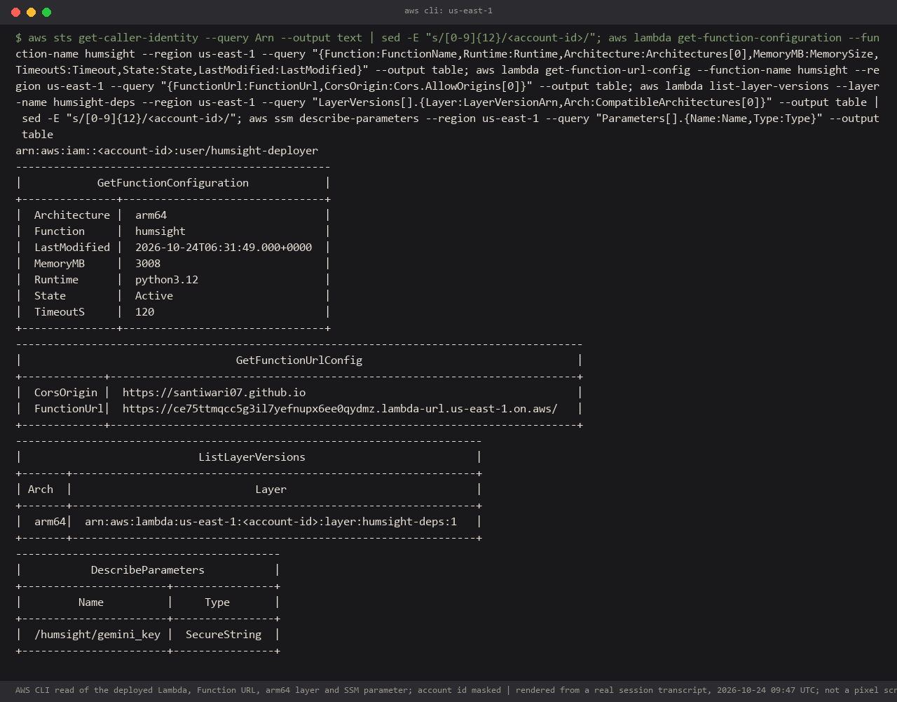<br><b>The function.</b> <code>humsight</code>: arm64, python3.12, 3008 MB, Active. Its Function URL, the arm64 dependency layer, and the Gemini key as an SSM SecureString.</td>
<td width="50%" valign="top">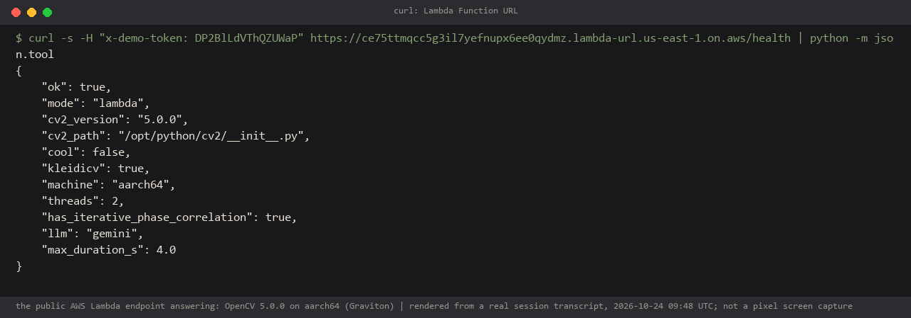<br><b>The endpoint answering.</b> OpenCV 5.0.0 on aarch64, in Lambda.</td>
</tr>
<tr>
<td valign="top">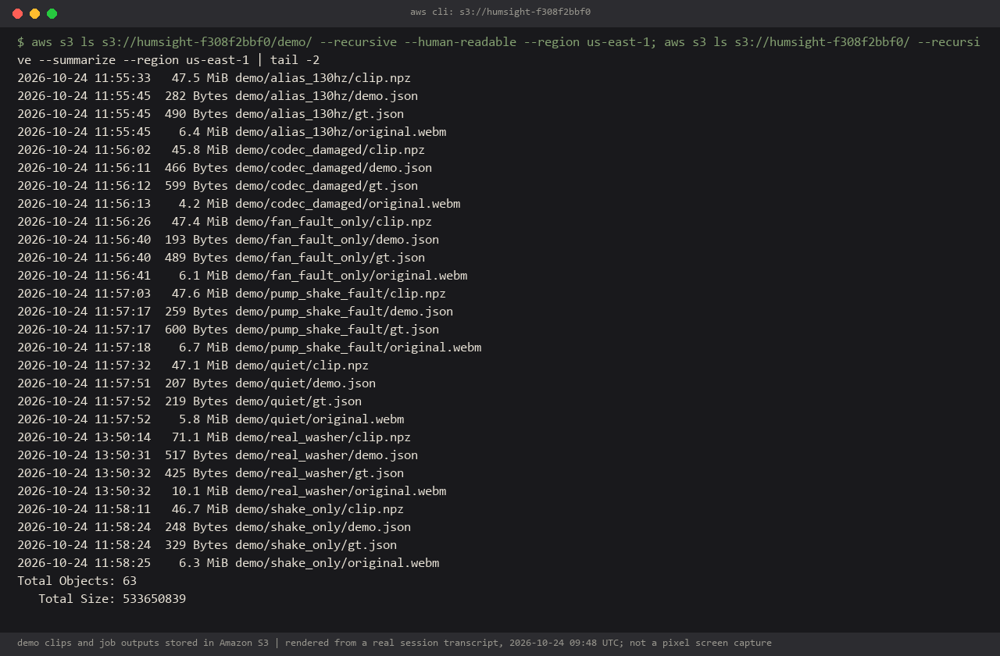<br><b>S3.</b> The demo clips the page offers, and the outputs each job writes.</td>
<td valign="top">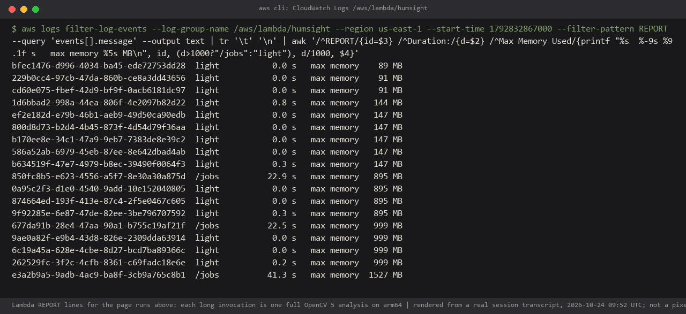<br><b>CloudWatch.</b> One Lambda invocation per analysis: 22.9 s and 22.5 s for the pump runs above, 41.3 s for the washing machine.</td>
</tr>
</table>

During the screenshot run the page received 12 responses from AWS: `GET /health`, `GET /demo-clips` and `POST /jobs` from the Function URL, then the magnified video, heatmap, spectrum and original clip from S3. The log is in [evidence/aws/live_page/network_log.json](evidence/aws/live_page/network_log.json).

### COOL on Graviton4

The whole pipeline and the web app also ran inside Cloud-Optimized OpenCV (COOL) on an EC2 `c8g.large` Spot instance (Graviton4) from the AWS Marketplace AMI, with stock OpenCV on the same instance as the baseline.

<table>
<tr>
<td width="50%" valign="top">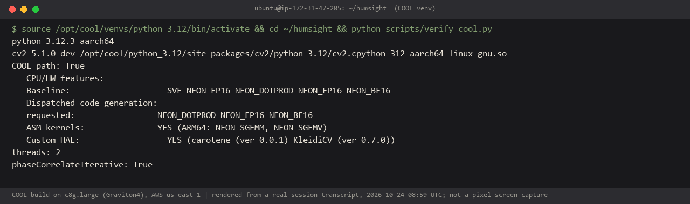<br><b>COOL loaded.</b> <code>cv2 5.1.0-dev</code> from <code>/opt/cool</code>, KleidiCV 0.7.0, SVE and NEON.</td>
<td width="50%" valign="top">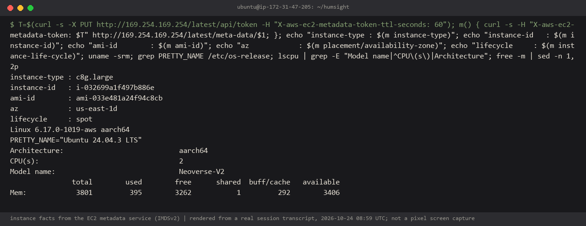<br><b>The instance.</b> <code>c8g.large</code>, Spot, us-east-1d, Neoverse-V2, from the instance metadata service.</td>
</tr>
<tr>
<td valign="top">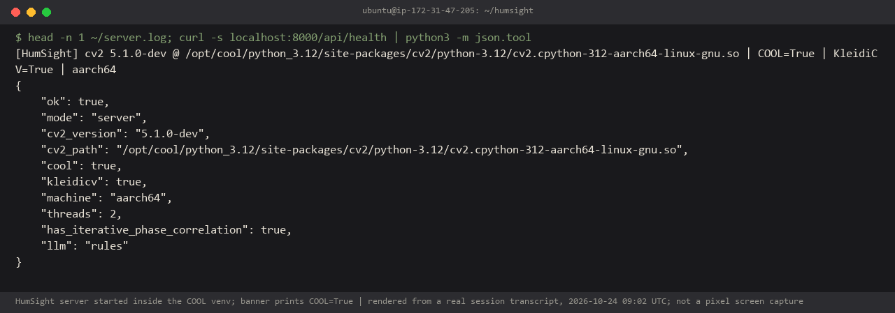<br><b>HumSight inside COOL.</b> The server banner and <code>/api/health</code> both report <code>COOL=True</code>.</td>
<td valign="top">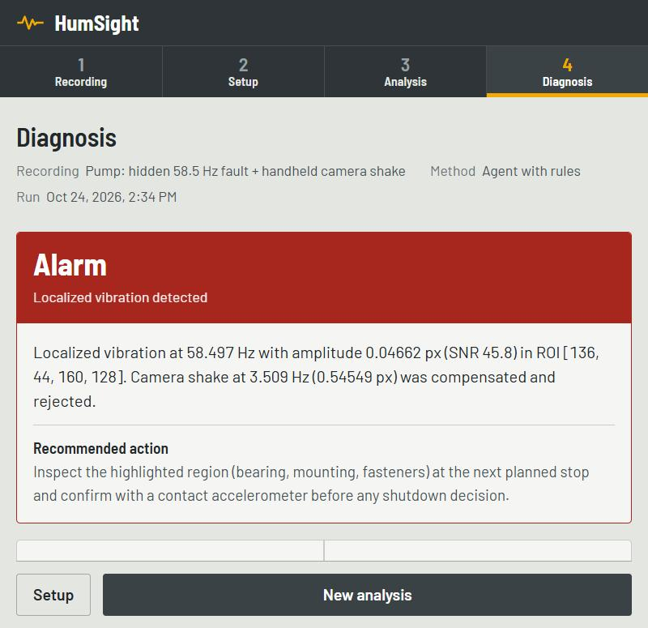<br><b>A full analysis</b> served and computed by the COOL instance.</td>
</tr>
</table>

**The result is a null result, and it is reported as one.** Totals across the pipeline stages were 0.98x to 1.03x of stock OpenCV, within the run-to-run spread. `resize` was 1.42x faster on COOL, `cvtColor` 0.83x. Compute cost was about $0.07 per 1,000 clips for both. The stages are dominated by per-patch FFTs and NumPy, which COOL does not specifically accelerate, and the stock aarch64 wheel already ships KleidiCV. The method, the per-stage tables and the caveats are in [docs/COOL.md](docs/COOL.md).

<sub>The page screenshots are real pixel captures in Chrome. The terminal images are real command output (AWS CLI, <code>curl</code>, <code>ssh</code>) recorded with its timings and rendered by <code>scripts/evidence_terminal.py</code>. They are not screen captures, and each says so in its footer. The account id is masked. Indexes: <a href="evidence/aws/README.md">evidence/aws/</a> and <a href="evidence/README.md">evidence/</a>.</sub>

## The competition, point by point

HumSight was built for the [OpenCV AI Competition 2026, powered by AWS](https://opencv26.devpost.com/), on both featured paths.

**Core requirements**

| Requirement | Where |
|---|---|
| OpenCV 5 for substantive image or video analysis | Sub-pixel phase correlation, optical flow, MAGSAC homography, pyramids and connected components in [`humsight/`](humsight/) |
| A meaningful component on AWS | Lambda, S3, SSM and CloudWatch serve every analysis; EC2 Graviton4 ran COOL. [Running on AWS](#running-on-aws) |
| Technical report | [docs/TECHNICAL_REPORT.md](docs/TECHNICAL_REPORT.md): problem, users, architecture, OpenCV 5, AWS, evaluation, limitations, responsible use |
| Pinned dependencies, build, deployment and test instructions | [`requirements.txt`](requirements.txt), [`requirements-lambda.txt`](requirements-lambda.txt), [docs/JUDGING.md](docs/JUDGING.md), [docs/DEPLOYMENT.md](docs/DEPLOYMENT.md) (executed, with every fix) |
| Architecture diagram | [docs/architecture.svg](docs/architecture.svg), [docs/agent_workflow.svg](docs/agent_workflow.svg) |
| Working web endpoint | [santiwari07.github.io/HumSight](https://santiwari07.github.io/HumSight/), calling the Lambda Function URL |
| Evaluation with failure cases | [eval/results/summary.md](eval/results/summary.md), [eval/results/failure_cases.md](eval/results/failure_cases.md) |
| Video of five minutes or less | Still to be recorded |

**Agentic Vision with OpenCV 5**

| The competition asks for | HumSight |
|---|---|
| Vision results that change a later tool call, action or request for human approval | Background motion triggers `compensate_shake`; a localized peak triggers a fine scan of that region; an alias or flicker flag ends in a request for review |
| An agent workflow diagram | [docs/agent_workflow.svg](docs/agent_workflow.svg) and [How HumSight thinks](#how-humsight-thinks) |
| A trace where OpenCV output changes a later decision | [The worked example](#a-worked-example-the-pump), [docs/example_trace.md](docs/example_trace.md), and the activity log of every run |
| Task success | Rules agent 12 of 12, live Gemini 11 of 12 then 12 of 12 on a rerun, fixed pipeline 5 of 12 |
| Failure handling and observability | Number guard, call budget, schema checks, rules fallback, a per-step trace with timings, CloudWatch logs |
| Appropriate human control | The agent cannot act on the machine. Its strongest action is a work order, and an uncertain case goes back to a person |

**Best Use of COOL**

| The competition asks for | HumSight |
|---|---|
| COOL executes the core workload on Graviton | The whole pipeline and the web app ran in the COOL environment on a `c8g.large` |
| COOL version and instance configuration | COOL `cv2 5.1.0-dev`, KleidiCV 0.7.0, AMI `ami-033e481a24f94c8cb`, Spot, us-east-1d |
| A reproducible method, inputs, baseline and results | [`bench/bench.py`](bench/bench.py): per-stage timings, one warm-up and seven runs, one and two threads, stock OpenCV 5.0.0 on the same instance ([bench/RESULTS.md](bench/RESULTS.md)) |

**Judging criteria**

| Criterion | Weight | Where HumSight answers it |
|---|---:|---|
| Technical execution | 30 % | Sub-pixel motion, shake compensation and band-limited magnification, with accuracy measured against ground truth |
| Innovation | 20 % | A camera as a grid of sensors, an agent that separates shake from a fault, a number guard, an *Inconclusive* path |
| Real-world impact | 20 % | A vibration check on machines that have no sensor, with the phone already in the technician's pocket |
| User experience | 10 % | Four guided steps, plain verdicts, side-by-side video, re-recording advice |
| Documentation and presentation | 10 % | This page, the technical report, the judging guide, the diagrams |
| Cloud delivery, reproducibility, responsible operation | 10 % | A live Lambda deployment, a step-by-step deployment guide, budgets, input caps, secrets in SSM, object expiry, a teardown checklist |

## Measured, not claimed

Every number below is generated by a script in this repository ([eval/results/summary.md](eval/results/summary.md)). E1 to E6 use synthetic clips with exact sub-pixel ground truth.

| Evaluation | Result |
|---|---|
| E1, frequency | Median error 0.005 Hz at 0.05 px of motion (noise 0.005), 0.002 Hz at 0.1 px |
| E2, amplitude | Median error 3.2 % at 0.1 px, 6.3 % at 0.05 px (noise 0.005) |
| E3, smallest motion detected 90 % of the time | 0.02, 0.05 and 0.1 px at noise 0.002, 0.005 and 0.01, with no false alarm on 10 empty clips |
| E3b, after lossy re-encoding | 3 to 6 false alarms in 10 empty clips: transfer the original file |
| E4, localization | 24 of 24 faults found in the right part |
| E5, agent against a fixed pipeline | Rules agent 12 of 12; Gemini 11 of 12, then 12 of 12 on a rerun; fixed pipeline 5 of 12 |
| E6, aliasing | 9 of 9 aliased recordings sent to review when the expected frequency was given |
| Live on Lambda | Pump demo: 58.497 Hz found (truth 58.5 Hz), shake rejected, 22.5 to 22.9 s per run |
| COOL against stock | 0.98x to 1.03x in total, a null result |

The Gemini rerun went from 11 to 12 of 12. The code change made between the two runs was never triggered in the rerun, so the improvement is consistent with ordinary run-to-run variation and is not credited to it ([eval/results/E5.md](eval/results/E5.md)).

## What it cannot do yet

- **It is indicative, not certified.** No ISO 20816 zone is reported. Every report says *Indicative, camera-based measurement. Not a certified ISO assessment*, and recommends a contact accelerometer before any shutdown decision.
- **A negative is evidence, not a guarantee.** The report states the noise floor and the smallest motion it could have seen, and says *Inconclusive* when that floor is too high.
- **The frame rate sets the ceiling.** Only frequencies below half the capture rate can be measured. Without an expected frequency, a fault above that limit can alias to a wrong one (evaluation E6).
- **Compression destroys sub-pixel motion,** and can invent low-frequency motion of its own. Transfer the original file.
- **A machine that fills the frame** and moves as a whole looks like camera shake to this method.
- **Real footage is thin.** One real clip is shown, without a measured reference. The synthetic results are labelled synthetic everywhere.
- **The public endpoint takes clips of up to 4 seconds,** to keep Lambda time and cost bounded.

### Next

- A real-footage benchmark against a contact accelerometer or a phone's own motion sensor. The protocol is written (E8).
- ISO 20816 zones from a cited machine class, with an image scale from a reference object, so the report gives velocity in mm/s.
- Phase-based magnification, for larger amplification with fewer artefacts.
- Fixed cameras and trends: scheduled clips from a CCTV or Raspberry Pi camera, a trend per machine, an alert on change.
- A capture guide in the browser that checks frame rate, framing and steadiness before recording.
- Work orders sent straight to a maintenance system, and the tools offered over MCP so any agent can call them.
- COOL at a larger scale: bigger Graviton instances, batch processing, and throughput per dollar against x86.

## Run it

**Online:** open [santiwari07.github.io/HumSight](https://santiwari07.github.io/HumSight/), pick a recording, keep *Agent with rules*, and choose **Run analysis**. Run the pump clip again with **Fixed pipeline** to watch the naive approach magnify the shake instead of the fault.

**Locally**, with Python 3.12 or newer:

```bash
git clone https://github.com/SanTiwari07/HumSight && cd HumSight
python -m venv .venv && source .venv/bin/activate        # Windows: .venv\Scripts\activate
pip install -r requirements.txt
python scripts/make_demo_clips.py                        # deterministic demo clips, about 50 MB each, not in git
uvicorn server.app:app --port 8000                       # open http://localhost:8000
```

Gemini is optional. Put `GEMINI_API_KEY=...` in a `.env` file at the repository root (git-ignored); without it the rules policy runs the same tools.

Run the tests with `python -m pytest`. The expected result for every demo clip is in [docs/JUDGING.md](docs/JUDGING.md).

## Reference

<details>
<summary><b>The demo clips and what to expect</b></summary>

| Clip | Truth | Expected result |
|---|---|---|
| `pump_shake_fault` | 58.5 Hz, 0.05 px fault; 3.5 Hz, 0.6 px camera shake | Alarm near 58.5 Hz, shake compensated and rejected |
| `fan_fault_only` | 24.5 Hz, 0.10 px, steady camera | Alarm near 24.5 Hz, no shake step |
| `shake_only` | Camera shake only | Normal |
| `quiet` | Nothing | Normal |
| `alias_130hz` | 130 Hz at 240 fps, expected frequency given | Inconclusive (aliasing) after two tool calls |
| `codec_damaged` | The pump scene after an mp4v round trip | A wrong result, a spurious low-frequency fault: a documented failure case |
| `real_washer` | Real footage, handheld, 120 fps; display reads 1400 RPM | Alarm near 22.7 Hz, shake removed |

</details>

<details>
<summary><b>Deploying to AWS</b></summary>

[docs/DEPLOYMENT.md](docs/DEPLOYMENT.md) is the exact sequence that was run on 24 October 2026, with the problems hit along the way and their fixes:

1. Guards first: a zero-spend budget and a $1 budget with alerts.
2. An S3 bucket with public access blocked, a 7-day lifecycle on uploads and outputs, and CORS for the page.
3. The Gemini key as an SSM SecureString (optional).
4. `bash lambda_fn/build_layer.sh` builds the arm64 layer and function without Docker; then the IAM role, the function and its Function URL.
5. The demo clips to S3 with `scripts/upload_demo_s3.py`.
6. The page to GitHub Pages through the manual workflow in `.github/workflows/pages.yml`.
7. COOL on EC2 Spot: [docs/COOL.md](docs/COOL.md) and `scripts/ec2_setup.sh`.
8. Teardown: [scripts/teardown_checklist.md](scripts/teardown_checklist.md).

</details>

<details>
<summary><b>Regenerating the evidence</b></summary>

```bash
python eval/run_all.py            # E1 to E6 tables and plots, about 18 minutes on 12 cores; --quick for a smoke run
python eval/failure_cases.py      # failure cases with images
python scripts/export_trace.py    # agent traces into docs/example_trace.md
python scripts/embed_results.py   # copy generated results into the report
```

</details>

<details>
<summary><b>Configuration</b></summary>

| Variable | Default | Effect |
|---|---|---|
| `GEMINI_API_KEY` | none | Enables the *Agent (Gemini)* method. Without it, the rules policy runs. |
| `LLM_MODEL` | `gemini-flash-latest` | The Gemini model. |
| `GEMINI_MIN_INTERVAL_S` | `0` | Minimum seconds between Gemini calls, for rate-limited keys. |
| `MAX_DURATION_S` | `10` locally, `4` on Lambda | Longest clip accepted. |
| `MAX_WIDTH` | `960` | Lambda only: frames are downscaled to this width. |
| `BUCKET`, `GEMINI_PARAM`, `DEMO_TOKEN` | none | Lambda only: the S3 bucket, the SSM parameter name, and the speed-bump token the page sends. |
| `HUMSIGHT_FORCE_CODEC` | none | Force one output codec, so benchmarks compare the same work. |

</details>

<details>
<summary><b>Project layout</b></summary>

```
humsight/          the library, no web or cloud code: synth, io, texture, motion, spectrum, shake,
                   detect, magnify, severity, report, pipeline (the fixed baseline)
humsight/agent/    tools, state, trace, rules policy, Gemini provider, number guard, loop
server/            FastAPI and Server-Sent Events (local and EC2)
lambda_fn/         the Lambda handler and a Docker-free arm64 build
web/               the static page (GitHub Pages)
deploy/            S3, Lambda, CORS and IAM templates
bench/             the COOL against stock benchmark and its results
eval/              E1 to E8 scripts, failure cases, generated results
evidence/          COOL on EC2; evidence/aws/ for Lambda, S3 and CloudWatch
scripts/           demo clips, EC2 setup, COOL check, trace export, S3 upload, evidence rendering
tests/             accuracy checkpoint, units, agent behaviour, Gemini wiring, Lambda, server
docs/              technical report, diagrams, example trace, deployment, COOL, judging guide, brand/
demo_clips/        demo metadata and ground truth (the clips are generated, not committed)
```

</details>

## Sources

**The problem**

1. Siemens, *The True Cost of Downtime 2024*: unplanned downtime costs the world's 500 biggest companies 11 % of their revenues, about $1.4 trillion. <https://assets.new.siemens.com/siemens/assets/api/uuid:1b43afb5-2d07-47f7-9eb7-893fe7d0bc59/TCOD-2024_original.pdf>
2. Waide and Brunner, *Energy-Efficiency Policy Opportunities for Electric Motor-Driven Systems*, International Energy Agency, 2011: electric motor-driven systems account for more than 40 % of global electricity consumption. <https://www.iea.org/reports/energy-efficiency-policy-opportunities-for-electric-motor-driven-systems>

**Methods**

3. Wu, Rubinstein, Shih, Guttag, Durand and Freeman, *Eulerian Video Magnification for Revealing Subtle Changes in the World*, ACM Transactions on Graphics (SIGGRAPH) 2012. <https://people.csail.mit.edu/mrub/evm/>
4. Iterative phase correlation as implemented in OpenCV (`cv2.phaseCorrelateIterative`), after Hrazdíra et al.
5. Cloud-Optimized OpenCV (COOL) for AWS Graviton, on AWS Marketplace.

**Data and licences**

- **Real demo clip:** "Washing machine 120fps" by Golha, CC BY-SA 4.0, via Wikimedia Commons. <https://commons.wikimedia.org/wiki/File:Washing_machine_120fps.webm>
- **All other clips** are synthetic, generated by `humsight/synth.py` with exact ground truth.
- **Code:** MIT licence, see [LICENSE](LICENSE).

<p align="center"><br><sub><b>HumSight</b> · See what machines are humming.</sub></p>
