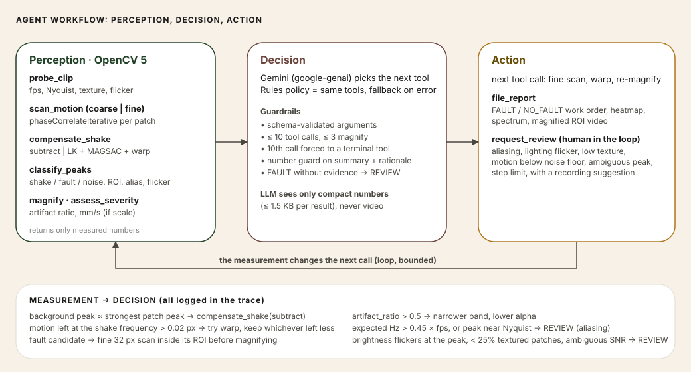
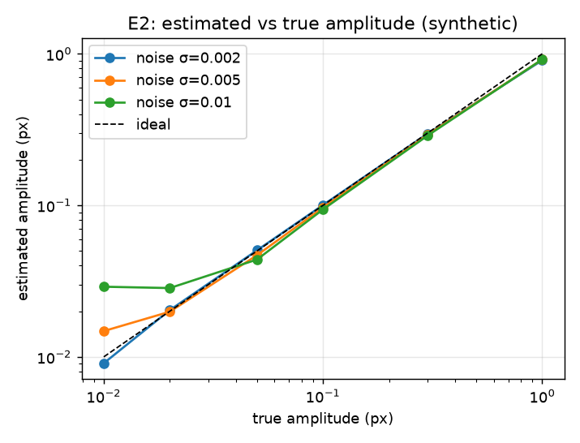

# HumSight: technical report

*See what machines are humming.* OpenCV AI Competition 2026, powered by AWS.

> **Status of this report.** Everything about the software, the agent and the evaluation is measured on this repository's code with synthetic ground truth. The AWS deployment (Lambda, S3, SSM, GitHub Pages) and the COOL-on-Graviton4 benchmark **were run on 24 Oct 2026** (sections 5 and 6); the COOL benchmark found no meaningful speed-up, and that is reported as measured. Numbers in this report are copied from generated files by `python scripts/embed_results.py`; none is typed by hand.

## 1. Problem and users

Pumps, motors, fans and pipes vibrate abnormally before they fail. Contact sensors measure this well but must be fitted machine by machine, and a phone video of a machine looks perfectly still to the eye. Naively magnifying "all motion" in such a video also amplifies camera shake and compression noise, which makes the result misleading.

**Users.** A reliability or maintenance engineer who wants a quick, non-contact vibration check from a phone or a fixed camera; secondarily students and labs teaching vibration analysis.

**What HumSight does.** It turns a video into a grid of virtual vibration sensors (OpenCV 5 phase correlation per patch), decides whether the motion is a localised machine fault, camera shake or noise (an agent), and shows the fault by magnifying only the faulty region in the chosen frequency band. When the evidence is not good enough it says so (`REVIEW`) and tells the user how to re-record.

**Non-goals.** Certified ISO 20816 assessment, live streaming, hardware, trained deep models.

## 2. Architecture


- `humsight/` is a pure library (no web or cloud code). The same code runs on a laptop, on Lambda and on the COOL instance.
- `server/` (FastAPI + SSE, local and EC2) and `lambda_fn/` (Function URL handler) wrap the library. `web/` is a static page that talks to either.
- Dashed shapes in the diagram are AWS components that are designed and have code in the repo (handler tested against a fake S3) but are not deployed yet.

## 3. OpenCV 5 implementation

| Stage | OpenCV 5 / NumPy | What it does |
|---|---|---|
| Decode, downscale | `VideoCapture`, `resize(INTER_AREA)`, `cvtColor(YCrCb)` | luma frames; a mandatory `capture_fps` guards against slow-motion files that report 30 fps |
| Which patches to trust | `GaussianBlur`, `Sobel` | gradient energy per patch; low-texture patches are dropped |
| Sub-pixel motion | `phaseCorrelateIterative` (Hann-windowed, `L2size=5`) | per-patch shift against a reference frame, every frame |
| Spectrum | NumPy FFT | detrend, Hann window, parabolic peak, sine-fit amplitude (unbiased), SNR vs in-band median |
| Shake, method A | NumPy | median background displacement subtracted |
| Shake, method B | `goodFeaturesToTrack`, `calcOpticalFlowPyrLK`, `findHomography(USAC_MAGSAC)`, `warpPerspective` | stabilise rotation/zoom shake, re-measure |
| Localise | `connectedComponentsWithStats` | largest component of fault patches becomes the ROI; a 32 px fine scan refines it |
| Magnify | `pyrDown`, `pyrUp`, FFT band-pass | linear Eulerian magnification (Wu et al. 2012) in the ROI only, finest level not amplified, α clipped to the small-motion bound |
| Report | `applyColorMap`, `VideoWriter` | heatmap, magnified video, spectrum JSON, work order |

**A measured design decision.** Plain `cv2.phaseCorrelate` produced gross outliers on the blurred-noise test textures; `phaseCorrelateIterative` (exposed in the OpenCV 5.0 Python wheel) did not. `L2size` and windowing were tuned against known shifts: `L2size=5` with a Hann pre-window kept amplitude within about 8% at realistic noise and 10% on clean data. See the E2 table below for the full accuracy picture, including its limits.

**Ground truth.** `humsight/synth.py` generates clips with exactly known frequency, amplitude and location (Fourier-shift sub-pixel motion, no interpolation blur), camera shake with drift, noise, JPEG and codec degradation. Every claim in the evaluation is checked against it.

## 4. Agentic design



The agent runs a bounded perception → decision → action loop over eight typed tools (`probe_clip`, `scan_motion`, `compensate_shake`, `classify_peaks`, `magnify`, `assess_severity`, `request_review`, `file_report`). Each tool returns only values measured by OpenCV/NumPy code; the LLM (Gemini via `google-genai`) chooses the next tool and writes prose, and a deterministic rules policy runs the same tools if the model is unavailable or fails mid-job (the trace records `rules (fallback: …)`).

**Visual evidence changes what happens next.** Examples from real runs (full traces in [example_trace.md](example_trace.md)):

- The coarse scan reports a background peak (0.545 px at 3.509 Hz) as strong as the strongest patch, so the agent calls `compensate_shake` before it classifies anything.
- A fault candidate triggers a fine scan inside its own ROI before magnification.
- An expected frequency above 0.45 × fps ends the job at step 2 with `REVIEW` and a recording suggestion; low texture, lighting flicker at the peak, an ambiguous SNR or a noise floor too high to trust a negative do the same.
- `artifact_ratio > 0.5` narrows the band and lowers α; residual motion at the shake frequency above `WARP_RESIDUAL_PX` after `subtract` tries `warp` and keeps whichever left less.

**Observability and control.** Every tool call is a trace event (arguments, full result, source, rationale, runtime), streamed live over SSE or replayed on Lambda. Humans stay in the loop through `REVIEW`.

**Guardrails.** Schema-validated arguments; at most 10 tool calls and 3 magnifications, with the 10th call forced to a terminal tool; a `FAULT` verdict with no classified fault (or `NO_FAULT` with one, or with no textured patch) is downgraded to `REVIEW`; the **number guard** compares every number in the model's summary and rationale with the tool results (2% tolerance, small integers allowed as counts) and substitutes a template summary when one is unverified (tested with a scripted "lying" provider); the model never sees video, only compact numeric results (≤ 1.5 KB).

**What is and is not verified.** The Gemini provider is tested against a fake client (conversation wiring, schema declarations, loop integration) and was run live against the real API on the Lambda deployment (headline demo) and twice on all 12 E5 clips (`eval/e5_gemini.py`, table below). **Before** a change to `file_report`: 84 of 84 tool calls were chosen by the model, none fell back to the rules policy, 11 of 12 verdicts were correct and no camera-shake peak was magnified; the one miss (shake only #2, REVIEW instead of NO_FAULT) was a procedural error by the model: it called `compensate_shake` a third time and then `file_report` without re-running `classify_peaks`, and a guard turned the unsupported NO_FAULT into REVIEW (a safe escalation, not a false alarm). `file_report` was then changed to refuse a stale classification and tell the model to run `classify_peaks`. **After** the change: 89 of 89 calls chosen by the model, no fallbacks, 12 of 12 correct. **But the new refusal fired 0 times in that run**, and the model's tool sequence differed between the two runs on 6 of 12 clips, so the improvement is best read as ordinary run-to-run variation of the model, not as an effect of the change; one run per clip each cannot separate the two. The change itself is covered by unit tests with a scripted model and has not been exercised against the live model. One model, temperature 0.2. The other evaluation tables (E1 to E4, E6) use the rules policy.

## 5. AWS deployment

**Design** (see [DEPLOYMENT.md](DEPLOYMENT.md) for the exact steps):

- Public endpoint for judges: AWS Lambda (arm64, python3.12, 3008 MB, 120 s) behind a Function URL; uploads go straight to S3 by presigned PUT, outputs come back as presigned GET URLs; clips are capped at 4 s; reserved concurrency 2 and an `X-Demo-Token` header limit abuse; the Gemini key is an SSM SecureString read once per cold start; S3 blocks public access and expires objects after 7 days.
- Live session: an EC2 `c8g.large` Spot instance from the COOL Graviton4 AMI runs the FastAPI server for screen-share demos and the benchmark, then is terminated.
- Controls: a zero-spend budget and a $1 budget before anything is launched; teardown checklist in `scripts/teardown_checklist.md`.

**Status: deployed and tested** (us-east-1). Lambda `humsight` (arm64, python3.12, 3008 MB, 120 s) with the OpenCV 5 layer, a private S3 bucket, an SSM SecureString for the Gemini key and a public Function URL; the page at https://santiwari07.github.io/HumSight/ calls it. Measured on this deployment: the headline demo returns FAULT at 58.497 Hz in 18 s wall time with the rules policy and in 42 s with the Gemini policy (8 model-chosen calls); a healthy-machine demo returns NO_FAULT in 4 s. Not done: reserved concurrency (the default account quota of 10 does not allow it) and a load test. The EC2/COOL benchmark was run separately (section 6).

## 6. COOL on Graviton4

The benchmark harness (`bench/bench.py`) times each pipeline stage and a set of OpenCV micro-operations for COOL and a stock OpenCV on the same instance (one warm-up, 7 timed runs, 1 and 2 threads, median and IQR, cost per 1,000 clips). Smoke-tested on a laptop with two identical stock environments it reported about 1.00x per stage: that is the noise floor. The COOL build offers only the `mp4v` codec, so the benchmark forces `mp4v` in both builds to keep the encode stage comparable.

**Status: run on 24 Oct 2026, with a null result.** The whole pipeline executed on COOL (`cv2 5.1.0-dev`, KleidiCV 0.7.0) on a Spot `c8g.large`, and a stock `opencv-python-headless==5.0.0.93` on the same machine was the baseline. Stage totals were within 0.98x to 1.03x: **we measured no meaningful speed-up**. `resize` was 1.42x faster and `cvtColor` 0.83x (slower); everything else was within about ±8%. Caveats: the OpenCV versions differ (5.1.0-dev vs 5.0.0), the stock aarch64 wheel already ships KleidiCV, and this was one small run (2 vCPUs, 480x270 clips because the default size ran out of memory). [COOL.md](COOL.md) has the configuration, method, caveats and the evidence list; screenshots and renders are in [../evidence/](../evidence/README.md).

<!-- EMBED:bench/RESULTS.md -->
COOL vs stock OpenCV benchmark

- **cool**: cv2 5.1.0-dev @ `/opt/cool/python_3.12/site-packages/cv2/python-3.12/cv2.cpython-312-aarch64-linux-gnu.so` (COOL=True, KleidiCV=True), 2026-10-24T08:46:24+00:00
- **stock**: cv2 5.0.0 @ `/home/ubuntu/stock/lib/python3.12/site-packages/cv2/__init__.py` (COOL=False, KleidiCV=True), 2026-10-24T08:52:26+00:00
- machine: Linux ip-172-31-47-205 6.17.0-1019-aws #19~24.04.1-Ubuntu SMP Tue Jun 23 18:34:05 UTC 2026 aarch64 aarch64 aarch64 GNU/Linux · instance c8g.large · AMI ami-033e481a24f94c8cb
- 7 timed runs after 1 warm-up; median (IQR) in ms. Speedup = stock / cool.

Numbers below are generated by `bench/bench.py --compare`; nothing is retyped.

## synth_clean, cv2.setNumThreads(1)

| stage | cool | stock | speedup |
|---|---|---|---|
| load+downscale | 201.8 (1.2) | 185.1 (2.3) | 0.92x |
| stabilise(warp) | 3959.2 (8.1) | 4256.1 (13.6) | 1.08x |
| patch_shifts(coarse) | 2369.2 (0.8) | 2363.3 (3.4) | 1.00x |
| patch_shifts(fine) | 564.6 (1.1) | 548.0 (0.7) | 0.97x |
| spectra | 48.1 (0.2) | 48.7 (0.2) | 1.01x |
| magnify(ROI) | 151.1 (1.3) | 148.9 (0.5) | 0.99x |
| encode | 297.7 (2.4) | 287.4 (1.7) | 0.97x |
| **total** | **7592** | **7838** | **1.03x** |

Compute cost per 1,000 clips at $0.0332/h: cool $0.070 · stock $0.072

## synth_clean, cv2.setNumThreads(2)

| stage | cool | stock | speedup |
|---|---|---|---|
| load+downscale | 168.7 (24.8) | 161.2 (9.4) | 0.96x |
| stabilise(warp) | 3376.1 (9.9) | 3497.8 (8.8) | 1.04x |
| patch_shifts(coarse) | 2403.5 (9.1) | 2363.8 (3.0) | 0.98x |
| patch_shifts(fine) | 639.1 (3.2) | 548.0 (0.6) | 0.86x |
| spectra | 48.3 (0.4) | 48.5 (0.3) | 1.00x |
| magnify(ROI) | 149.9 (0.8) | 148.5 (0.9) | 0.99x |
| encode | 297.4 (1.6) | 285.9 (4.6) | 0.96x |
| **total** | **7083** | **7054** | **1.00x** |

Compute cost per 1,000 clips at $0.0332/h: cool $0.065 · stock $0.065

## synth_shake, cv2.setNumThreads(1)

| stage | cool | stock | speedup |
|---|---|---|---|
| load+downscale | 203.2 (4.1) | 185.8 (4.6) | 0.91x |
| stabilise(warp) | 4839.4 (11.8) | 4946.5 (10.6) | 1.02x |
| patch_shifts(coarse) | 2951.7 (2.0) | 2901.7 (5.8) | 0.98x |
| patch_shifts(fine) | 807.3 (0.5) | 777.5 (4.4) | 0.96x |
| spectra | 48.0 (0.3) | 48.5 (0.1) | 1.01x |
| magnify(ROI) | 150.2 (0.9) | 149.0 (0.7) | 0.99x |
| encode | 384.9 (2.7) | 371.6 (4.4) | 0.97x |
| **total** | **9385** | **9381** | **1.00x** |

Compute cost per 1,000 clips at $0.0332/h: cool $0.087 · stock $0.087

## synth_shake, cv2.setNumThreads(2)

| stage | cool | stock | speedup |
|---|---|---|---|
| load+downscale | 192.2 (25.8) | 181.9 (12.3) | 0.95x |
| stabilise(warp) | 4084.3 (9.3) | 4111.1 (31.2) | 1.01x |
| patch_shifts(coarse) | 2995.0 (13.2) | 2899.6 (6.2) | 0.97x |
| patch_shifts(fine) | 886.2 (4.7) | 778.5 (0.9) | 0.88x |
| spectra | 48.1 (0.5) | 48.5 (0.2) | 1.01x |
| magnify(ROI) | 149.1 (0.9) | 148.7 (0.6) | 1.00x |
| encode | 384.8 (5.3) | 370.3 (2.5) | 0.96x |
| **total** | **8740** | **8539** | **0.98x** |

Compute cost per 1,000 clips at $0.0332/h: cool $0.081 · stock $0.079

## Micro-benchmark (microseconds per call, 640x360 float32)

### threads=1

| op | cool | stock | speedup |
|---|---|---|---|
| GaussianBlur | 390.1 | 389.4 | 1.00x |
| pyrDown | 70.2 | 70.6 | 1.01x |
| pyrUp | 376.2 | 375.7 | 1.00x |
| warpPerspective | 632.7 | 615.4 | 0.97x |
| phaseCorrelate(64x64) | 61.9 | 64.5 | 1.04x |
| phaseCorrelateIterative(64x64) | 109.4 | 112.5 | 1.03x |
| cvtColor(BGR2YCrCb) | 358.3 | 298.0 | 0.83x |
| resize(INTER_AREA 0.5x) | 19.7 | 27.9 | 1.42x |
| Sobel | 114.2 | 111.6 | 0.98x |
| findContours | 11133.6 | 11239.2 | 1.01x |

### threads=2

| op | cool | stock | speedup |
|---|---|---|---|
| GaussianBlur | 396.1 | 385.6 | 0.97x |
| pyrDown | 43.3 | 42.3 | 0.98x |
| pyrUp | 376.9 | 372.2 | 0.99x |
| warpPerspective | 338.6 | 311.5 | 0.92x |
| phaseCorrelate(64x64) | 64.6 | 64.9 | 1.00x |
| phaseCorrelateIterative(64x64) | 117.3 | 113.4 | 0.97x |
| cvtColor(BGR2YCrCb) | 180.6 | 150.7 | 0.83x |
| resize(INTER_AREA 0.5x) | 19.9 | 28.2 | 1.42x |
| Sobel | 117.8 | 113.8 | 0.97x |
| findContours | 11221.7 | 11259.6 | 1.00x |

If COOL is not faster on a stage, that is the result: for example NumPy FFT and Python-level loops dominate several stages and COOL does not accelerate NumPy.
<!-- /EMBED -->

## 7. Evaluation

Synthetic ground truth only (256×192 clips, 4 s, fixed seeds), generated by `python eval/run_all.py`. The real-clip experiment E8 (fan with a coin on one blade) has not been run.

<!-- EMBED:eval/results/summary.md -->
HumSight evaluation summary

Generated by `python eval/run_all.py` in 1069 s. Seeds fixed (base 42). Synthetic clips: 256x192, 4 s. cv2 5.0.0. Thresholds: SNR_MIN=6.0, K_LOCAL=3.0.
## E1 Frequency accuracy (pass A: fps 240, no shake, 4 s, Δf = 0.25 Hz)

Error |f̂ − f| measured on the patches fully inside the vibrating part, median over patches.

| amp (px) | noise σ | n | median |Δf| (Hz) | p95 |Δf| (Hz) | median (bins) | p95 (bins) |
|---|---|---|---|---|---|---|
| 0.01 | 0.002 | 5 | 7.093 | 27.18 | 28.37 | 108.7 |
| 0.01 | 0.005 | 5 | 22.31 | 69.94 | 89.26 | 279.8 |
| 0.01 | 0.01 | 5 | 51.23 | 66.87 | 204.9 | 267.5 |
| 0.02 | 0.002 | 5 | 0.001605 | 0.01583 | 0.006422 | 0.06331 |
| 0.02 | 0.005 | 5 | 0.01432 | 43.28 | 0.05727 | 173.1 |
| 0.02 | 0.01 | 5 | 36.76 | 64.94 | 147 | 259.8 |
| 0.05 | 0.002 | 5 | 0.001892 | 0.003703 | 0.007568 | 0.01481 |
| 0.05 | 0.005 | 5 | 0.004798 | 0.01361 | 0.01919 | 0.05442 |
| 0.05 | 0.01 | 5 | 0.03421 | 16.97 | 0.1369 | 67.87 |
| 0.1 | 0.002 | 5 | 0.001266 | 0.003103 | 0.005065 | 0.01241 |
| 0.1 | 0.005 | 5 | 0.002261 | 0.004779 | 0.009046 | 0.01912 |
| 0.1 | 0.01 | 5 | 0.01076 | 0.01898 | 0.04306 | 0.07594 |
| 0.3 | 0.002 | 5 | 0.0006024 | 0.001323 | 0.00241 | 0.005294 |
| 0.3 | 0.005 | 5 | 0.001146 | 0.002249 | 0.004586 | 0.008997 |
| 0.3 | 0.01 | 5 | 0.001043 | 0.002066 | 0.004172 | 0.008262 |
| 1.0 | 0.002 | 5 | 5.117e-05 | 0.0002344 | 0.0002047 | 0.0009375 |
| 1.0 | 0.005 | 5 | 0.0001732 | 0.000671 | 0.0006928 | 0.002684 |
| 1.0 | 0.01 | 5 | 0.0006319 | 0.001262 | 0.002527 | 0.005047 |

### Pass B (f = 24.5 Hz, amp 0.05 px, noise 0.005)

| fps | shake | f̂ (Hz) | Â (px) | SNR | detected | ROI IoU |
|---|---|---|---|---|---|---|
| 60 | none | 24.48 | 0.04516 | 2.73 | False | n/a |
| 60 | 3.5 Hz | 20.78 | 0.03794 | 3.407 | False | n/a |
| 60 | 3.5 Hz + drift | 24.48 | 0.04349 | 3.535 | True | 0.046 |
| 120 | none | 24.49 | 0.04732 | 5.994 | True | 0.35 |
| 120 | 3.5 Hz | 24.51 | 0.04895 | 5.834 | True | 0.71 |
| 120 | 3.5 Hz + drift | 24.48 | 0.04175 | 5.976 | True | 0.35 |
| 240 | none | 24.51 | 0.04974 | 7.763 | True | 0.71 |
| 240 | 3.5 Hz | 24.48 | 0.04022 | 7.769 | True | 0.35 |
| 240 | 3.5 Hz + drift | 24.5 | 0.04873 | 8.769 | True | 0.69 |

## E2 Amplitude accuracy (pass A)

Relative error |Â − A| / A, median over patches inside the part.

| amp (px) | noise σ | n | median rel. err | p95 rel. err | median  (px) |
|---|---|---|---|---|---|
| 0.01 | 0.002 | 5 | 0.0998 | 0.194 | 0.009076 |
| 0.01 | 0.005 | 5 | 0.48 | 0.606 | 0.0148 |
| 0.01 | 0.01 | 5 | 1.9 | 2.01 | 0.02903 |
| 0.02 | 0.002 | 5 | 0.0659 | 0.145 | 0.02035 |
| 0.02 | 0.005 | 5 | 0.147 | 0.258 | 0.01985 |
| 0.02 | 0.01 | 5 | 0.422 | 0.509 | 0.02845 |
| 0.05 | 0.002 | 5 | 0.0232 | 0.0561 | 0.05051 |
| 0.05 | 0.005 | 5 | 0.0629 | 0.123 | 0.04686 |
| 0.05 | 0.01 | 5 | 0.123 | 0.278 | 0.04387 |
| 0.1 | 0.002 | 5 | 0.027 | 0.0544 | 0.1005 |
| 0.1 | 0.005 | 5 | 0.032 | 0.0394 | 0.0968 |
| 0.1 | 0.01 | 5 | 0.0603 | 0.117 | 0.09397 |
| 0.3 | 0.002 | 5 | 0.00965 | 0.0162 | 0.2971 |
| 0.3 | 0.005 | 5 | 0.0222 | 0.0294 | 0.2933 |
| 0.3 | 0.01 | 5 | 0.0382 | 0.0472 | 0.2885 |
| 1.0 | 0.002 | 5 | 0.0943 | 0.095 | 0.9057 |
| 1.0 | 0.005 | 5 | 0.0824 | 0.0825 | 0.9176 |
| 1.0 | 0.01 | 5 | 0.0815 | 0.0855 | 0.9185 |



## E3 Detection floor

f = 24.5 Hz, fps 240, 10 seeds per cell, no shake. Detection = a classified fault within 2 bins.

| noise σ | amp (px) | detection rate |
|---|---|---|
| 0.002 | 0.01 | 0% |
| 0.002 | 0.02 | 100% |
| 0.002 | 0.05 | 100% |
| 0.002 | 0.1 | 100% |
| 0.002 | 0.3 | 100% |
| 0.002 | 1.0 | 100% |
| 0.005 | 0.01 | 0% |
| 0.005 | 0.02 | 0% |
| 0.005 | 0.05 | 100% |
| 0.005 | 0.1 | 100% |
| 0.005 | 0.3 | 100% |
| 0.005 | 1.0 | 100% |
| 0.01 | 0.01 | 0% |
| 0.01 | 0.02 | 0% |
| 0.01 | 0.05 | 20% |
| 0.01 | 0.1 | 100% |
| 0.01 | 0.3 | 100% |
| 0.01 | 1.0 | 100% |

| noise σ | detection floor (px, ≥90%) | false positives on empty clips |
|---|---|---|
| 0.002 | 0.02 | 0/10 |
| 0.005 | 0.05 | 0/10 |
| 0.01 | 0.1 | 0/10 |

## E3b Codec impact (mp4v round-trip)

f = 24.5 Hz, fps 240, 10 seeds per cell, no shake. Detection = a classified fault within 2 bins.

| noise σ | amp (px) | detection rate |
|---|---|---|
| 0.002 | 0.01 | 0% |
| 0.002 | 0.02 | 0% |
| 0.002 | 0.05 | 80% |
| 0.002 | 0.1 | 100% |
| 0.002 | 0.3 | 100% |
| 0.002 | 1.0 | 100% |
| 0.005 | 0.01 | 0% |
| 0.005 | 0.02 | 0% |
| 0.005 | 0.05 | 100% |
| 0.005 | 0.1 | 100% |
| 0.005 | 0.3 | 100% |
| 0.005 | 1.0 | 100% |
| 0.01 | 0.01 | 0% |
| 0.01 | 0.02 | 0% |
| 0.01 | 0.05 | 30% |
| 0.01 | 0.1 | 100% |
| 0.01 | 0.3 | 100% |
| 0.01 | 1.0 | 100% |

| noise σ | detection floor (px, ≥90%) | false positives on empty clips |
|---|---|---|
| 0.002 | 0.1 | 6/10 |
| 0.005 | 0.05 | 4/10 |
| 0.01 | 0.1 | 3/10 |

## E4 Localisation

Fault injected into 1 of 4 textured parts (0.1 px); the other parts are static. Hit = verdict FAULT and final ROI IoU ≥ 0.3 with the true part.

**Hit rate: 24/24 = 100%**

| true part | f (Hz) | verdict | IoU | hit |
|---|---|---|---|---|
| 0 | 58.5 | FAULT | 0.56 | yes |
| 2 | 24.5 | FAULT | 0.56 | yes |
| 1 | 58.5 | FAULT | 0.56 | yes |
| 0 | 40.0 | FAULT | 0.56 | yes |
| 0 | 15.0 | FAULT | 0.56 | yes |
| 2 | 58.5 | FAULT | 0.56 | yes |
| 2 | 58.5 | FAULT | 0.56 | yes |
| 2 | 58.5 | FAULT | 0.56 | yes |
| 2 | 15.0 | FAULT | 0.56 | yes |
| 3 | 24.5 | FAULT | 0.56 | yes |
| 2 | 24.5 | FAULT | 0.56 | yes |
| 0 | 58.5 | FAULT | 0.56 | yes |
| 3 | 40.0 | FAULT | 0.56 | yes |
| 1 | 58.5 | FAULT | 0.56 | yes |
| 2 | 24.5 | FAULT | 0.56 | yes |
| 1 | 15.0 | FAULT | 0.56 | yes |
| 0 | 40.0 | FAULT | 0.56 | yes |
| 3 | 15.0 | FAULT | 0.56 | yes |
| 3 | 58.5 | FAULT | 0.56 | yes |
| 1 | 40.0 | FAULT | 0.56 | yes |
| 0 | 58.5 | FAULT | 0.56 | yes |
| 2 | 24.5 | FAULT | 0.56 | yes |
| 0 | 58.5 | FAULT | 0.56 | yes |
| 1 | 58.5 | FAULT | 0.56 | yes |

## E5 Agent vs fixed pipeline

12 clips (4 groups x 3): shake + hidden fault, shake only, fault only, nothing. ✓ = correct verdict (and for FAULT, the right frequency). 'shake magnified' = the reported fault frequency is the camera-shake frequency.

| clip | truth | agent (rules) | agent (Gemini, before) | agent (Gemini, after) | fixed pipeline |
|---|---|---|---|---|---|
| shake+fault #1 | FAULT | FAULT ✓ | FAULT ✓ | FAULT ✓ | FAULT ✗ · shake magnified |
| shake+fault #2 | FAULT | FAULT ✓ | FAULT ✓ | FAULT ✓ | FAULT ✗ · shake magnified |
| shake+fault #3 | FAULT | FAULT ✓ | FAULT ✓ | FAULT ✓ | FAULT ✗ · shake magnified |
| shake only #1 | NO_FAULT | NO_FAULT ✓ | NO_FAULT ✓ | NO_FAULT ✓ | FAULT ✗ · shake magnified |
| shake only #2 | NO_FAULT | NO_FAULT ✓ | REVIEW ✗ | NO_FAULT ✓ | FAULT ✗ · shake magnified |
| shake only #3 | NO_FAULT | NO_FAULT ✓ | NO_FAULT ✓ | NO_FAULT ✓ | FAULT ✗ · shake magnified |
| fault only #1 | FAULT | FAULT ✓ | FAULT ✓ | FAULT ✓ | NO_FAULT ✗ |
| fault only #2 | FAULT | FAULT ✓ | FAULT ✓ | FAULT ✓ | FAULT ✓ |
| fault only #3 | FAULT | FAULT ✓ | FAULT ✓ | FAULT ✓ | FAULT ✓ |
| nothing #1 | NO_FAULT | NO_FAULT ✓ | NO_FAULT ✓ | NO_FAULT ✓ | NO_FAULT ✓ |
| nothing #2 | NO_FAULT | NO_FAULT ✓ | NO_FAULT ✓ | NO_FAULT ✓ | NO_FAULT ✓ |
| nothing #3 | NO_FAULT | NO_FAULT ✓ | NO_FAULT ✓ | NO_FAULT ✓ | NO_FAULT ✓ |

| policy | correct | shake wrongly magnified |
|---|---|---|
| agent (rules) | 12/12 | 0 |
| agent (Gemini, before) | 11/12 | 0 |
| agent (Gemini, after) | 12/12 | 0 |
| fixed pipeline | 5/12 | 6 |

**Gemini, before** live API run on 2026-10-24 (model `gemini-flash-latest`, code at commit `835bf9d`, sequential, paced at 7 s between calls): 84 of 84 tool calls were chosen by the model; 12 of 12 clips ran entirely on Gemini and 0 fell back to the rules policy partway; the number guard fired 0 time(s); `file_report` was refused for a stale classification 0 time(s).

**Gemini, after** live API run on 2026-10-24 (model `gemini-flash-latest`, code at commit `de57672`, sequential, paced at 7 s between calls): 89 of 89 tool calls were chosen by the model; 12 of 12 clips ran entirely on Gemini and 0 fell back to the rules policy partway; the number guard fired 0 time(s); `file_report` was refused for a stale classification 0 time(s).

'before' = the first run, when `file_report` silently downgraded a verdict filed without a current classification; 'after' = the rerun in which `file_report` returns an error telling the model to run `classify_peaks`. Both runs used the same clips, model, prompt and settings, one run per clip each.

**How to read the difference (11/12 before, 12/12 after).** In the 'after' run the new refusal fired 0 time(s), so the change was never exercised against the live model. The model's tool sequence nevertheless differed between the two runs on 6 of 12 clips. The change of outcome on the failing clip therefore cannot be credited to the change: it is consistent with ordinary run-to-run variation of the model, and one run each cannot separate the two. What the change is known to do is covered by unit tests with a scripted model (a stale `file_report` is refused, the model can classify again and then file).
### Gemini run details (before)

| clip | verdict | calls (model / total) | tool sequence | refusals / guard notes | seconds |
|---|---|---|---|---|---|
| shake+fault #1 | FAULT | 8/8 | probe clip > scan motion > compensate shake > classify peaks > scan motion > assess severity > magnify > file report | - | 61.5 |
| shake+fault #2 | FAULT | 8/8 | probe clip > scan motion > compensate shake > classify peaks > scan motion > assess severity > magnify > file report | - | 59.2 |
| shake+fault #3 | FAULT | 8/8 | probe clip > scan motion > compensate shake > classify peaks > scan motion > assess severity > magnify > file report | - | 72.0 |
| shake only #1 | NO_FAULT | 7/7 | probe clip > scan motion > compensate shake > classify peaks > compensate shake > classify peaks > file report | - | 60.0 |
| shake only #2 | REVIEW | 8/8 | probe clip > scan motion > compensate shake > classify peaks > compensate shake > classify peaks > compensate shake > file report | NO_FAULT filed before classify_peaks; downgraded to REVIEW | 63.9 |
| shake only #3 | NO_FAULT | 8/8 | probe clip > scan motion > compensate shake > classify peaks > scan motion > compensate shake > classify peaks > file report | - | 66.3 |
| fault only #1 | FAULT | 7/7 | probe clip > scan motion > classify peaks > scan motion > assess severity > magnify > file report | - | 54.0 |
| fault only #2 | FAULT | 7/7 | probe clip > scan motion > classify peaks > scan motion > assess severity > magnify > file report | - | 50.8 |
| fault only #3 | FAULT | 7/7 | probe clip > scan motion > classify peaks > scan motion > assess severity > magnify > file report | - | 48.3 |
| nothing #1 | NO_FAULT | 6/6 | probe clip > scan motion > classify peaks > scan motion > scan motion > file report | - | 51.5 |
| nothing #2 | NO_FAULT | 6/6 | probe clip > scan motion > classify peaks > scan motion > classify peaks > file report | - | 47.9 |
| nothing #3 | NO_FAULT | 4/4 | probe clip > scan motion > classify peaks > file report | - | 45.7 |

### Gemini run details (after)

| clip | verdict | calls (model / total) | tool sequence | refusals / guard notes | seconds |
|---|---|---|---|---|---|
| shake+fault #1 | FAULT | 8/8 | probe clip > scan motion > compensate shake > classify peaks > scan motion > assess severity > magnify > file report | - | 61.8 |
| shake+fault #2 | FAULT | 8/8 | probe clip > scan motion > compensate shake > classify peaks > scan motion > assess severity > magnify > file report | - | 59.0 |
| shake+fault #3 | FAULT | 8/8 | probe clip > scan motion > compensate shake > classify peaks > scan motion > assess severity > magnify > file report | - | 60.1 |
| shake only #1 | NO_FAULT | 7/7 | probe clip > scan motion > compensate shake > classify peaks > compensate shake > classify peaks > file report | - | 60.3 |
| shake only #2 | NO_FAULT | 7/7 | probe clip > scan motion > compensate shake > classify peaks > compensate shake > classify peaks > file report | - | 61.7 |
| shake only #3 | NO_FAULT | 7/7 | probe clip > scan motion > compensate shake > classify peaks > compensate shake > classify peaks > file report | - | 58.1 |
| fault only #1 | FAULT | 7/7 | probe clip > scan motion > classify peaks > scan motion > magnify > assess severity > file report | - | 48.7 |
| fault only #2 | FAULT | 7/7 | probe clip > scan motion > classify peaks > scan motion > assess severity > magnify > file report | - | 49.5 |
| fault only #3 | FAULT | 7/7 | probe clip > scan motion > classify peaks > scan motion > assess severity > magnify > file report | - | 48.4 |
| nothing #1 | NO_FAULT | 9/9 | probe clip > scan motion > classify peaks > scan motion > scan motion > scan motion > compensate shake > classify peaks > file report | - | 70.6 |
| nothing #2 | NO_FAULT | 8/8 | probe clip > scan motion > classify peaks > scan motion > scan motion > compensate shake > classify peaks > file report | - | 58.2 |
| nothing #3 | NO_FAULT | 6/6 | probe clip > scan motion > classify peaks > scan motion > classify peaks > file report | - | 61.5 |

## E6 Aliasing guard

**9/9 = 100% flagged REVIEW** when the expected frequency is given (target 100%). Last column: what happens when the user gives no expected frequency (the guard cannot know, the search band stops at 0.45 x fps).

| fps | f (Hz) | verdict (expected_hz given) | verdict (not given) |
|---|---|---|---|
| 60 | 28.8 | REVIEW | NO_FAULT |
| 60 | 36.0 | REVIEW | FAULT |
| 60 | 48.0 | REVIEW | FAULT |
| 120 | 57.6 | REVIEW | REVIEW |
| 120 | 72.0 | REVIEW | FAULT |
| 120 | 96.0 | REVIEW | FAULT |
| 240 | 115.2 | REVIEW | REVIEW |
| 240 | 144.0 | REVIEW | FAULT |
| 240 | 192.0 | REVIEW | FAULT |

## E8 Real clip (fan + coin)

Not run: no real clip present at `demo_clips/real_fan/`. Record one with the protocol in docs/planning/IMPLEMENTATION.md §10 and run `python eval/e8_real.py <clip> --capture-fps 240 --expected-hz <phyphox Hz>`. Synthetic results above are labelled synthetic.
<!-- /EMBED -->

## 8. Failure cases and limitations

Cases built to break the tool (`python eval/failure_cases.py`), reported as found:

<!-- EMBED:eval/results/failure_cases.md -->
Failure cases

Built to break the tool; results are reported as found.

| case | scene | ideal outcome | actual verdict | findings | probe warnings |
|---|---|---|---|---|---|
| Codec damage | 58.5 Hz, 0.05 px fault + shake, after mp4v round-trip | FAULT at 58.5 Hz | NO_FAULT | [] | - |
| Aliasing, frequency not given | 144 Hz fault recorded at 240 fps (Nyquist 120 Hz) | REVIEW (aliasing) | FAULT | [[96.001, 0.18284]] | - |
| Low texture | 24.5 Hz, 0.1 px fault on a nearly flat surface (6% contrast) | FAULT at 24.5 Hz or REVIEW | REVIEW | [] | low texture: only 0% of patches are usable |
| Large motion | 15 Hz, 6 px fault (far outside the sub-pixel regime) | one FAULT at 15 Hz, amplitude 6 px | FAULT | [[15.0, 5.63568], [104.978, 0.08597], [59.979, 0.06831]] | - |
| Lighting flicker | no motion; 100 Hz mains-light brightness modulation (8%) | NO_FAULT or REVIEW | REVIEW | [] | lighting flicker suspected near 100.0 Hz |

## Codec damage

- scene: 58.5 Hz, 0.05 px fault + shake, after mp4v round-trip
- ideal: FAULT at 58.5 Hz
- actual: **NO_FAULT** - No localized vibration above SNR 6.0. Noise floor 0.003089 px; minimum detectable amplitude about 0.018533 px.
- texture coverage: 1.0; noise floor: 0.003089 px; lighting_flicker: False
- why: The encoder's motion compensation and quantisation smooth sub-pixel motion away; the noise floor looks normal, so the clip looks quiet. Use a high-bitrate / lossless original, never a messaging-app copy.


## Aliasing, frequency not given

- scene: 144 Hz fault recorded at 240 fps (Nyquist 120 Hz)
- ideal: REVIEW (aliasing)
- actual: **FAULT** - Localized vibration at 96.001 Hz with amplitude 0.18284 px (SNR 521.89) in ROI [64, 32, 128, 96].
- texture coverage: 1.0; noise floor: 0.005396 px; lighting_flicker: False
- why: Without expected_hz the guard cannot know. The 144 Hz motion folds to 96 Hz and is reported there as a confident FAULT. Give an expected Hz/RPM whenever possible.


## Low texture

- scene: 24.5 Hz, 0.1 px fault on a nearly flat surface (6% contrast)
- ideal: FAULT at 24.5 Hz or REVIEW
- actual: **REVIEW** - low texture: only 0% of patches have enough gradient energy for sub-pixel tracking
- texture coverage: 0.0; noise floor: None px; lighting_flicker: None
- why: Phase correlation needs gradient energy. Patches below TEXTURE_MIN are dropped; with almost none left the agent must ask for review rather than report a negative (an earlier version filed NO_FAULT here: fixed).

_No heatmap: the agent stopped before measuring any motion._

## Large motion

- scene: 15 Hz, 6 px fault (far outside the sub-pixel regime)
- ideal: one FAULT at 15 Hz, amplitude 6 px
- actual: **FAULT** - Localized vibration at 15.0 Hz with amplitude 5.63568 px (SNR 7548.47) in ROI [96, 32, 96, 96].
- texture coverage: 1.0; noise floor: 0.005586 px; lighting_flicker: False
- why: Magnification and the sub-pixel estimator assume small motion. The main peak is found (amplitude within a few percent) but the estimator's nonlinearity adds spurious harmonic peaks that are also classified as faults; do not trust secondary findings or magnification for motion of several pixels.


## Lighting flicker

- scene: no motion; 100 Hz mains-light brightness modulation (8%)
- ideal: NO_FAULT or REVIEW
- actual: **REVIEW** - lighting flicker coincides with the detected peak (mean frame brightness oscillates)
- texture coverage: 1.0; noise floor: 0.005375 px; lighting_flicker: True
- why: Guard case: brightness oscillation is flagged from the mean-frame signal instead of being read as motion.


<!-- /EMBED -->

Other limitations:

- Sub-pixel amplitude has a measurable floor: below about 0.02 px (low noise) to 0.1 px (high noise) the fault is not detected; a 1 px motion reads about 8% low.
- Frequency is only valid below Nyquist; the aliasing guard needs the expected Hz or RPM from the user.
- A machine that fills the frame and vibrates as a whole is indistinguishable from camera shake by this method.
- Real footage is only lightly tested: the E8 fan-with-coin experiment has not been run, and the one real clip (`real_washer`, a handheld washing machine) has no measured ground truth, only a display reading of 1400 RPM, so it is indicative, not an accuracy figure. Synthetic textures and noise are simpler than real scenes.
- Severity is indicative: ISO 20816 zones are not reported until thresholds from a cited part and machine class are configured.

## 9. Responsible use

- **Not a certified assessment.** Every report carries "Indicative, camera-based measurement. Not a certified ISO assessment." and the UI footer repeats it. A negative result is evidence, not a guarantee: the report states the noise floor and minimum detectable amplitude, and returns `REVIEW` when that floor is too high.
- **Honesty rules.** Every number comes from a script in the repo; synthetic results are labelled synthetic; no unsourced market or accuracy figures.
- **Privacy.** Only compact numeric summaries go to the LLM, never frames; free-tier Gemini inputs may be used by Google to improve its products. The Gemini key lives in SSM and a git-ignored `.env`, never in the repo.
- **Abuse and cost controls.** Input caps (size, duration, resolution), upload type allow-list, presigned URLs with short expiry, concurrency limit, budgets, 7-day object expiry.
- **Human control.** The agent cannot act on the machine; its strongest action is a report, and ambiguous cases are escalated.

## 10. Reproducibility

```bash
pip install -r requirements.txt            # pinned
python -m pytest                           # 33 tests
python scripts/make_demo_clips.py          # deterministic demo clips
python eval/run_all.py                     # regenerates every table and plot (about 18 min on 12 cores)
python eval/failure_cases.py
python scripts/export_trace.py             # regenerates docs/example_trace.md
python scripts/embed_results.py            # copies generated results into README and this report
```

Versions used for the results above: OpenCV 5.0.0 (`opencv-python-headless==5.0.0.93`), NumPy 2.5.4, Python 3.13 on Windows. The Lambda deployment runs the same pinned versions on Python 3.12 arm64 (aarch64 wheels, checked at the ELF level).

## 11. Credits

Built by Team HoloDuet: Sanskar Tiwari and Shambhavi Patil.

Wu, Rubinstein, Shih, Guttag, Durand, Freeman, *Eulerian Video Magnification for Revealing Subtle Changes in the World*, SIGGRAPH 2012. Hrazdira et al., iterative phase correlation (as implemented in OpenCV). OpenCV and Cloud-Optimized OpenCV (COOL). Fraunces and Hanken Grotesk (open fonts) for the UI. The demo clips in this repository are synthetic, except `real_washer`, a handheld 120 fps washing-machine video from Wikimedia Commons (CC BY-SA 4.0).
