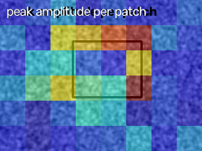
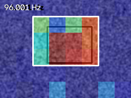
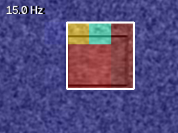
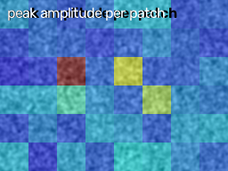

# Failure cases

Built to break the tool; results are reported as found.

| case | scene | ideal outcome | actual verdict | findings | probe warnings |
|---|---|---|---|---|---|
| Codec damage | 58.5 Hz, 0.05 px fault + shake, after mp4v round-trip | FAULT at 58.5 Hz | NO_FAULT | [] | - |
| Aliasing, frequency not given | 144 Hz fault recorded at 240 fps (Nyquist 120 Hz) | REVIEW (aliasing) | FAULT | [[96.001, 0.18284]] | - |
| Low texture | 24.5 Hz, 0.1 px fault on a nearly flat surface (6% contrast) | FAULT at 24.5 Hz or REVIEW | REVIEW | [] | low texture: only 0% of patches are usable |
| Large motion | 15 Hz, 6 px fault (far outside the sub-pixel regime) | one FAULT at 15 Hz, amplitude 6 px | FAULT | [[15.0, 5.63568], [104.978, 0.08597], [59.979, 0.06831]] | - |
| Lighting flicker | no motion; 100 Hz mains-light brightness modulation (8%) | NO_FAULT or REVIEW | REVIEW | [] | lighting flicker suspected near 100.0 Hz |

## Codec damage

- scene: 58.5 Hz, 0.05 px fault + shake, after mp4v round-trip
- ideal: FAULT at 58.5 Hz
- actual: **NO_FAULT** - No localized vibration above SNR 6.0. Noise floor 0.003089 px; minimum detectable amplitude about 0.018533 px.
- texture coverage: 1.0; noise floor: 0.003089 px; lighting_flicker: False
- why: The encoder's motion compensation and quantisation smooth sub-pixel motion away; the noise floor looks normal, so the clip looks quiet. Use a high-bitrate / lossless original, never a messaging-app copy.

## Aliasing, frequency not given

- scene: 144 Hz fault recorded at 240 fps (Nyquist 120 Hz)
- ideal: REVIEW (aliasing)
- actual: **FAULT** - Localized vibration at 96.001 Hz with amplitude 0.18284 px (SNR 521.89) in ROI [64, 32, 128, 96].
- texture coverage: 1.0; noise floor: 0.005396 px; lighting_flicker: False
- why: Without expected_hz the guard cannot know. The 144 Hz motion folds to 96 Hz and is reported there as a confident FAULT. Give an expected Hz/RPM whenever possible.

## Low texture

- scene: 24.5 Hz, 0.1 px fault on a nearly flat surface (6% contrast)
- ideal: FAULT at 24.5 Hz or REVIEW
- actual: **REVIEW** - low texture: only 0% of patches have enough gradient energy for sub-pixel tracking
- texture coverage: 0.0; noise floor: None px; lighting_flicker: None
- why: Phase correlation needs gradient energy. Patches below TEXTURE_MIN are dropped; with almost none left the agent must ask for review rather than report a negative (an earlier version filed NO_FAULT here: fixed).

_No heatmap: the agent stopped before measuring any motion._

## Large motion

- scene: 15 Hz, 6 px fault (far outside the sub-pixel regime)
- ideal: one FAULT at 15 Hz, amplitude 6 px
- actual: **FAULT** - Localized vibration at 15.0 Hz with amplitude 5.63568 px (SNR 7505.15) in ROI [96, 32, 96, 96].
- texture coverage: 1.0; noise floor: 0.005586 px; lighting_flicker: False
- why: Magnification and the sub-pixel estimator assume small motion. The main peak is found (amplitude within a few percent) but the estimator's nonlinearity adds spurious harmonic peaks that are also classified as faults; do not trust secondary findings or magnification for motion of several pixels.

## Lighting flicker

- scene: no motion; 100 Hz mains-light brightness modulation (8%)
- ideal: NO_FAULT or REVIEW
- actual: **REVIEW** - lighting flicker coincides with the detected peak (mean frame brightness oscillates)
- texture coverage: 1.0; noise floor: 0.005375 px; lighting_flicker: True
- why: Guard case: brightness oscillation is flagged from the mean-frame signal instead of being read as motion.

